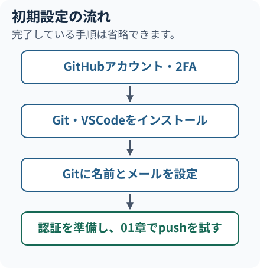
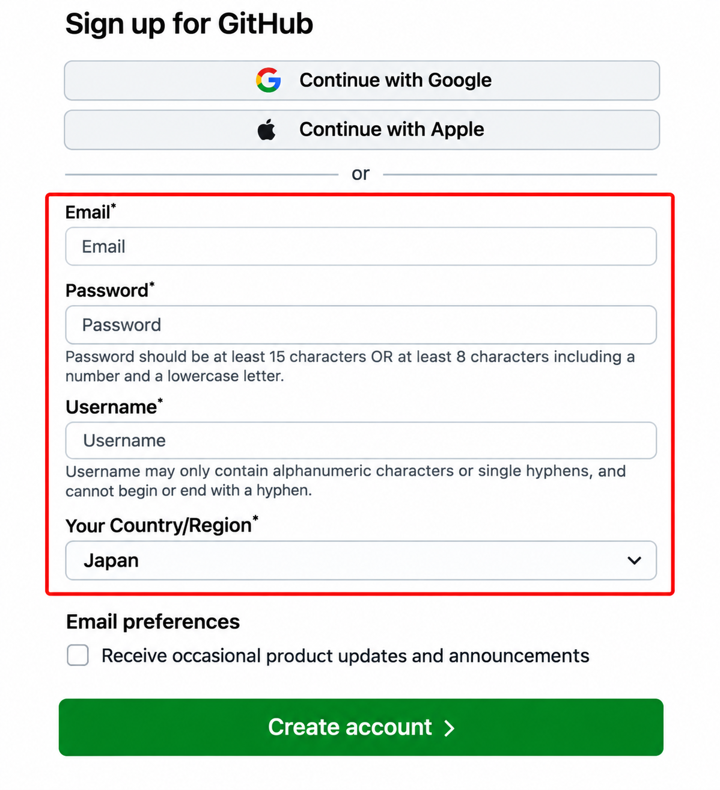
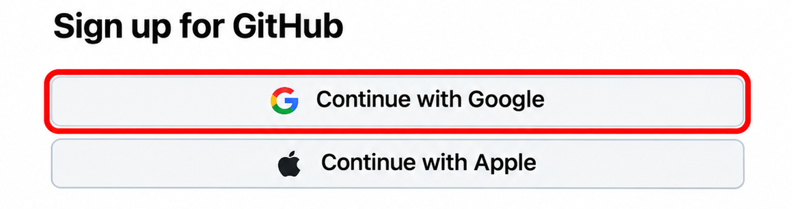
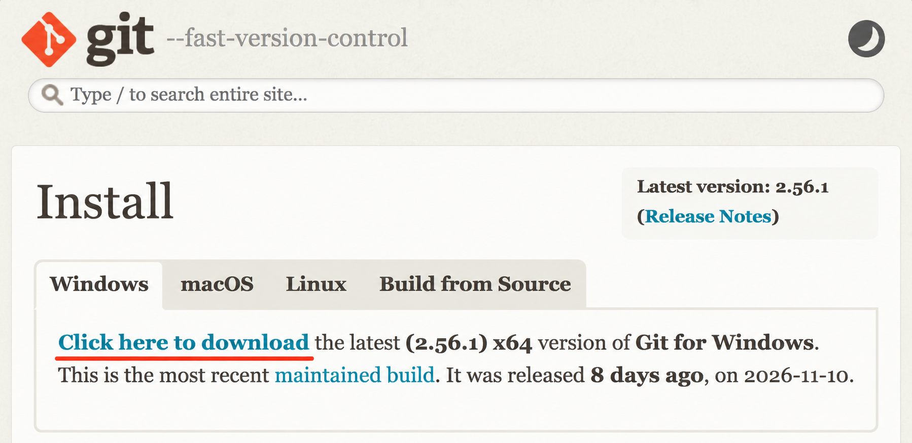

# 00 Git・GitHubのインストールと初期設定

[事前準備の案内に戻る](../README.md#事前準備) ｜ [本編 01 基本操作 →](01-basic.md)

> **対象**：Git・GitHubを初めて使う人  
> **想定環境**：Windows 11（Mac・Linuxは補足あり）  
> **所要時間**：約30〜45分（アカウント登録・ダウンロード状況によって変動）  
> **準備のゴール**：GitをPCで使えるようにし、GitHubアカウントと認証方法を準備する。

この資料は勉強会前の事前準備用です。準備が済んだら、本編の01章に進んでください。

すでにGitHubアカウントを持っている人やGitをインストール済みの人は、該当する手順を飛ばして構いません。

「プログラミング応用」の授業で作ったGitHubアカウントも使えます。



コマンド欄は1行ずつ入力してEnterを押します。出力例は、自分の画面に表示された結果と見比べてください。

## 目次

1. [GitとGitHubの違い](#1-gitとgithubの違い)
2. [GitHubアカウントを作成する](#2-githubアカウントを作成する)
3. [Gitをインストールする](#3-gitをインストールする)
4. [Visual Studio Codeをインストールする](#4-visual-studio-codeをインストールする)
5. [Gitに名前とメールアドレスを設定する](#5-gitに名前とメールアドレスを設定する)
6. [GitHubへの認証を準備する](#6-githubへの認証を準備する)
7. [初期設定の確認](#7-初期設定の確認)
8. [よくあるトラブル](#8-よくあるトラブル)
9. [補足：SSHとGitHub CLI](#9-補足sshとgithub-cli)
10. [参考資料（公式）](#参考資料公式)

---

## 1. GitとGitHubの違い

**Git** は、ファイルの変更履歴を記録・管理するためのソフトウェアです。**GitHub** は、Gitで管理したプロジェクトをオンラインで共有し、複数人で開発しやすくするサービスです。また、近年の論文ではGithubでの共有がとても多いので見方がわかるとよりよいでしょう。

| 用語 | 役割 | 例 |
|---|---|---|
| Git | 自分のPCで変更履歴を管理する | いつ・誰が・どのファイルを変更したか記録する |
| GitHub | リポジトリをオンラインで共有する | 他の人とコードを共有し、Pull Requestで変更を確認する |
| リポジトリ | プロジェクトのファイルと履歴を管理する場所 | 授業の演習用リポジトリ |
| コミット | 変更内容を履歴として記録する操作 | 「READMEに説明を追加」と記録する |

GitHubのWebサイトだけでもファイルの編集はできますが、**PCからGitのコマンドを使って操作するにはGitのインストールが必要**です。

---

## 2. GitHubアカウントを作成する

この教材でGitHubにリポジトリを作り、変更を送るには、GitHubアカウントが必要です。

すでにアカウントを持っている場合は、この手順を飛ばして「2-3. ログインの確認」に進んでください。

### 2-1. メールアドレスで登録する

1. [GitHub新規登録ページ](https://github.com/signup)にアクセスします。
2. メールアドレス・パスワード・ユーザー名などを、画面の案内に沿って入力します。
3. 「Create account」をクリックします。
4. 求められた認証（メール確認など）を完了します。



### 2-2. Googleアカウントで登録する

Googleアカウントを持っている場合は、Googleアカウントを利用して登録することもできます。

1. [GitHub新規登録ページ](https://github.com/signup)にアクセスします。
2. 「Continue with Google」をクリックします。
3. 使用するGoogleアカウントを選択します。
4. Googleアカウントで認証します。
5. GitHubの画面に戻ったら、ユーザー名などの必要事項を設定し、登録を完了します。



> **注意**：GoogleアカウントとGitHubアカウントは別のものです。Googleアカウントを利用して登録した場合でも、GitHubのユーザー名が設定されます。

### 2-3. ログインの確認

[ログインページ](https://github.com/login)からログインし、右上のプロフィールメニューで使う予定のアカウントか確認します。

> **注意**：GitHubのユーザー名はプロフィールURL（`https://github.com/ユーザー名`）に使われ、公開されます。一方、Gitのコミットに記録される作成者名は、後述の手順で、`git config --global user.name` に値を指定して設定するものです。必ずしも同じ名前である必要はありません。

### 2-4. 二要素認証（2FA）を設定する

二要素認証（2FA）は、サインイン時に認証アプリの確認コードなどを使う仕組みです。GitHubから設定を求められた場合は、画面の案内に従ってください。自分で設定する場合は **Settings → Password and authentication** を開きます。

**リカバリーコードは安全な場所に保管してください。** 他人に送ったり、公開リポジトリに置いたりしないでください。

認証情報を選ぶときや保管するときの考え方は、[08章のアカウントと認証情報](08-security.md#8-3-アカウントと認証情報を守る)を参照してください。

### 2-5. 大学生向け：GitHub Education（任意）

学生向けの特典に興味がある場合は、[GitHub Education](https://education.github.com/students)を確認してください。申請や在学確認が必要な場合があり、特典の内容・利用条件は変更されることがあります。

---

## 3. Gitをインストールする

### 3-1. Windows 11の場合

1. [Git公式：Windows向けインストール](https://git-scm.com/install/windows)を開きます。
2. Windows用インストーラーをダウンロードして起動します。
3. インストール画面を順に進めます。基本設定を利用できますが、**表示内容を確認してから**進めましょう。



特に確認しておきたい項目は次のとおりです。

- **Default editor**：普段VSCodeを使うなら、Visual Studio Codeを選ぶとコミットメッセージなどを編集しやすくなります。VSCodeが未インストールなら、教材の基本手順では既定のエディターのまま進められます。
- **PATH environment**：PATHは、ターミナルがコマンドを探す場所の一覧です。コマンドプロンプトやPowerShellからGitを使いたい場合は、コマンドラインから利用できる設定を選びます。
- **Credential helper**：選択肢が表示されたら **Git Credential Manager** を選びます。GitからGitHubに接続するとき、ブラウザでの認証を案内する機能です。
- **Initial branch name**：`main` を使う設定にしても構いません。インストール後にコマンドで指定することもできます。

<!-- スクリーンショット挿入候補（実画面）: Git for WindowsのPATHとCredential helperの選択画面。 -->

> **補足**：インストーラーの画面や選択肢はバージョンによって変わります。教材のスクリーンショットと異なる場合は、公式の説明も確認してください。

**Windowsの別の導入方法（任意）**：PowerShellなどで次を実行する方法もあります。

```powershell
winget install --id Git.Git -e --source winget
```

このコマンドはWindowsのパッケージ管理ツールでGitをインストールします。完了したら、ターミナルを開き直して3-4に進みます。

### 3-2. Macの場合（補足）

ターミナルで以下を実行し、表示される案内に従ってCommand Line Toolsを導入します。

```bash
xcode-select --install
```

Homebrewを利用している場合は `brew install git` も選択肢です。

### 3-3. Ubuntu系Linuxの場合（補足）

1行目はインストールできるソフトウェアの一覧を更新し、2行目でGitをインストールします。確認が表示された場合は内容を読んで続けます。

```bash
sudo apt update
sudo apt install git
```

### 3-4. インストールを確認する

Windows 11ではスタートメニューで「PowerShell」と検索して開きます。01章で使うコマンドプロンプトやGit Bashでも同じコマンドを実行できます。MacとLinuxではターミナルを開きます。

```bash
git --version
```

実行例：

```text
git version 2.xx.x.windows.x
```

`git --version` はインストール済みのGitのバージョンを表示します。番号や末尾は環境によって変わります。番号が表示されれば成功です。`git` が見つからない場合は、ターミナルを閉じて開き直してから再試行してください。

---

## 4. Visual Studio Codeをインストールする

VSCodeは必須ではありませんが、コードの編集やGitの操作に便利なエディタです。

講義などですでにインストールしている場合は、手順4から確認してください。

1. [VSCode公式サイト](https://code.visualstudio.com/)を開きます。
2. 自分のOS向けのインストーラーをダウンロードします。
3. インストール後、VSCodeを起動します。
4. **ターミナル → 新しいターミナル（Terminal → New Terminal）** を選びます。Windows 11では画面下にPowerShellが開く場合があります。
5. ターミナルで `git --version` を実行し、バージョン番号が表示されることを確認します。Gitのインストール前からVSCodeを開いていた場合は、VSCodeを終了して開き直します。

<!-- スクリーンショット挿入候補（実画面）: VSCodeの新しいターミナルと git --version の結果。 -->

> **補足**：VSCodeはGitの操作画面を備えていますが、PC側にGitがインストールされている必要があります。

---

## 5. Gitに名前とメールアドレスを設定する

Gitのコミットには、作成者の名前とメールアドレスが記録されます。最初に設定しておきましょう。以下のコマンドは、リポジトリを作る前でもVSCodeのターミナルから実行できます。

名前とメールアドレスは自分の値に置き換えます。コミットをGitHubアカウントに紐づけるには、GitHubで確認済みのメールアドレスか、次の節の `noreply` アドレスを使います。設定に成功すると通常は何も表示されません。

```bash
git config --global user.name "表示したい名前"
git config --global user.email "your-email@example.com"
```

- `git config`：Gitの設定を変更・確認するコマンド
- `--global`：現在のPCユーザーに対する共通設定。リポジトリ単位の設定ではありません
- `user.name`：コミットに記録する作成者名
- `user.email`：コミットに記録するメールアドレス

### 5-1. メールアドレスを公開したくない場合

GitHubの **Settings → Emails** では、コミットに使用できる非公開用の `noreply` メールアドレスを確認できます。表示されたアドレスをコピーし、次のように設定します。

```bash
git config --global user.email "GitHubで確認したnoreplyアドレス"
```

**例の文字列をそのまま入力せず、自分のGitHubアカウントに表示されたアドレスを使ってください。** GitHubの「Keep my email addresses private」などの設定も確認しましょう。既存コミットのメールアドレスは、設定変更だけでは書き換わりません。

<!-- スクリーンショット挿入候補（実画面）: GitHubのSettings → Emails。個人のメールアドレスは伏せる。 -->

### 5-2. 初期ブランチ名を設定する（任意）

PCで `git init` を使って新しいリポジトリを作る場合に、最初のブランチ名を `main` にする設定です。01章のクローンではGitHub側の既定ブランチを使うので、この設定は省略できます。

```bash
git config --global init.defaultBranch main
```

### 5-3. 設定を確認する

```bash
git config --global user.name
git config --global user.email
git config --global init.defaultBranch
```

値を付けずに実行すると、現在の設定値が表示されます。次のように、入力した名前とメールアドレスが順に表示されれば成功です。

```text
Git学習者
learner@example.com
main
```

最後の行は5-2を実施した場合の例です。初期ブランチ名を設定していない場合、最後のコマンドは何も表示しないことがあります。

> **補足**：改行コードの設定（`core.autocrlf`）はOSやチームの方針に依存します。初期設定で必ず変更する必要はありません。共同開発では `.gitattributes` でルールを統一する方法もあります。

---

## 6. GitHubへの認証を準備する

GitHubのWebサイトへのログインと、PCのGitからGitHubにアクセスする際の認証は区別して考えます。

GitHubは、HTTPSでのGit操作に**アカウントのパスワードをそのまま入力する方式**をサポートしていません。Windows初心者には、**HTTPS + Git Credential Manager（GCM）** をおすすめします。

### 6-1. おすすめ：HTTPS + ブラウザ認証

Git for Windowsの一般的なインストールでは、Git Credential Managerを利用できます。GitHubへの認証が必要な操作をすると、ブラウザによるサインインが案内される場合があります。

1. GitHubにブラウザでログインできることを確認します。
2. Gitがインストールされていることを確認します。
3. [01章](01-basic.md)で、GitHub上のリポジトリを **HTTPSのURL** でクローン（PCにコピー）します。
4. pushなどで認証が必要になった場合は、ブラウザの案内に従い、練習用リポジトリを作ったアカウントでサインインします。以前の認証が保存されていれば、画面が出ない場合もあります。
5. pushが成功すれば認証も確認できます。

HTTPSのURLは次の形式です。

```text
https://github.com/ユーザー名/リポジトリ名.git
```

> **重要**：事前準備では、アカウントと認証の準備まで行います。**実際に変更を送れるかは01章のpush手順で確認します。** 事前準備の時点で認証画面が表示されなくても、異常とは限りません。

### 6-2. 認証方法の比較

| 方法 | 特徴 | この教材での扱い |
|---|---|---|
| HTTPS + GCM | ブラウザから認証でき、Windows初心者に扱いやすい | **基本ルート** |
| SSH鍵 | 鍵を登録してGitHubに接続する | 補足 |
| GitHub CLI (`gh`) | コマンドでGitHubにログイン・操作する | 補足 |
| Personal Access Token | 権限や有効期限を指定できる認証用トークン | 必要時のみ |

---

## 7. 初期設定の確認

次の項目をチェックしてください。

- [ ] GitHubアカウントを作成し、ログインできる
- [ ] 二要素認証を設定した場合は、リカバリーコードを安全に保管した
- [ ] `git --version` でバージョンが表示される
- [ ] VSCodeのターミナルでも `git --version` が実行できる
- [ ] `git config --global user.name` で設定した名前が表示される
- [ ] `git config --global user.email` で設定したメールアドレスが表示される
- [ ] HTTPSでGitHubにアクセスする方法を理解した

**次の章**では、リポジトリを作成し、`git clone` → 編集 → `git add .` → `git commit` → `git push` を実際に試します。

[事前準備の案内に戻る](../README.md#事前準備) ｜ [本編 01 基本操作 →](01-basic.md)

---

## 8. よくあるトラブル

### Q1. `git` が見つからない

**例**：`'git' is not recognized ...` や `git: command not found`

**対処**：ターミナルやVSCodeを再起動します。それでも解決しなければ、Gitがインストールされているか、PATH設定が適切か確認してください。

### Q2. `Author identity unknown` と表示される

コミットの作成者情報が設定されていない可能性があります。手順5の `user.name` と `user.email` を確認してください。

### Q3. GitHubにログインできるのにpushできない

ブラウザでGitHubにログインしていることと、Gitの認証が完了していることは別です。HTTPSのリモートURLを使っているか、Git Credential Managerの認証案内が出ていないか確認してください。

### Q4. GitHubのパスワードを入力しても認証されない

HTTPSでのGit操作では、アカウントのパスワードを直接使えません。ブラウザ認証（GCM）、SSH、または適切なPersonal Access Tokenを使用してください。

### Q5. メールアドレスが公開されないか心配

GitHubの **Settings → Emails** で `noreply` アドレスを確認し、Gitの `user.email` に設定してください。公開リポジトリへpushする前に確認するのがおすすめです。

---

## 9. 補足：SSHとGitHub CLI

初心者向けの基本ルートではありませんが、必要になった場合は以下を参照してください。

### 9-1. SSH鍵による認証

SSH鍵は、秘密鍵を自分のPCに保管し、公開鍵をGitHubに登録する仕組みです。秘密鍵は**絶対に公開しない**でください（プログラミング応用での認証はこっちでやった覚えがあります）。

```bash
ssh-keygen -t ed25519 -C "your-email@example.com"
```

保存先に既存の鍵がある場合は、上書きせず、既存の鍵を使うか公式手順を参照して別の鍵を設定してください。生成した公開鍵（通常 `~/.ssh/id_ed25519.pub`）をGitHubの **Settings → SSH and GPG keys** に登録します。SSH接続時にホスト鍵の確認が表示されたら、**GitHub公式のSSHキーフィンガープリントと照合してから**承認してください。

接続確認：

```bash
ssh -T git@github.com
```

成功時には、認証に成功したことと、GitHubがシェルアクセスを提供しないことを示すメッセージが表示されます。

詳しい手順：[GitHub公式：SSHでGitHubに接続する](https://docs.github.com/ja/authentication/connecting-to-github-with-ssh)

### 9-2. GitHub CLIによる認証

GitHub CLI（`gh`）は、GitHubの機能をコマンドラインから操作するツールです。

Windowsでのインストール例：

```powershell
winget install --id GitHub.cli -e
```

インストール後、ターミナルを開き直して以下を実行します。

```bash
gh auth login
```

画面の案内に従ってGitHub.comと認証方法を選択します。HTTPSでGit操作にも利用する場合は、案内に従ってGitの認証設定も行ってください。状態確認：

```bash
gh auth status
```

`gh auth status` の結果に、ログイン済みのGitHubアカウントが表示されれば確認完了です。

詳しい手順：[GitHub CLI公式マニュアル](https://cli.github.com/manual/gh_auth_login)

---

## 参考資料（公式）

- [Git公式：Windowsへのインストール](https://git-scm.com/install/windows)
- [GitHub公式：アカウントの作成](https://docs.github.com/ja/get-started/start-your-journey/creating-an-account-on-github)
- [GitHub公式：Gitのユーザー名の設定](https://docs.github.com/ja/get-started/git-basics/setting-your-username-in-git)
- [GitHub公式：コミットメールアドレスの設定](https://docs.github.com/ja/account-and-profile/how-tos/email-preferences/setting-your-commit-email-address)
- [GitHub公式：Gitの認証について](https://docs.github.com/ja/authentication/keeping-your-account-and-data-secure/about-authentication-to-github)
- [GitHub公式：SSH接続](https://docs.github.com/ja/authentication/connecting-to-github-with-ssh)
- [VSCode公式：Windowsへのインストール](https://code.visualstudio.com/docs/setup/windows)
- [Git Credential Manager公式](https://github.com/git-ecosystem/git-credential-manager)

---

[事前準備の案内に戻る](../README.md#事前準備) ｜ [本編 01 基本操作 →](01-basic.md)
