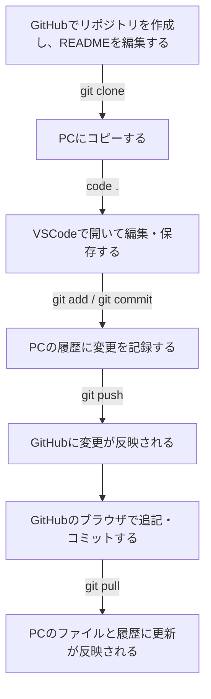
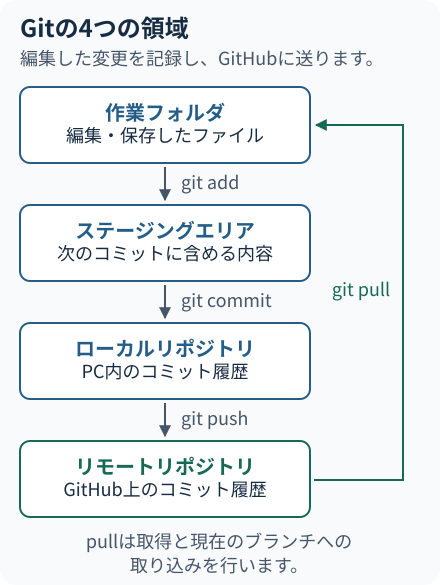

# 01 Git・GitHubの基本操作

> **対象**：Git・GitHubを初めて使う人  
> **目安時間**：45〜60分（操作練習を含む）  
> **ゴール**：GitHubでリポジトリを作り、PCにcloneし、VSCodeで編集した内容をpushできる。ブラウザ上の変更をpullで取り込める。

> **前提**：[事前準備資料](00-install.md)に沿って、Gitのインストールとユーザー名・メールアドレスの設定、GitHubへのログインと認証の準備を済ませ、PCで使うエディターを用意していること。

[事前準備資料](00-install.md) ｜ [目次に戻る](../README.md#目次) ｜ [02 ブランチの操作 →](02-branch.md)

---

## 1-1. GitとGitHubの基本

**Git** はファイルの変更履歴を記録する仕組み、**GitHub** はGitで管理するファイルをオンラインで共有できるサービスです。

| 用語 | 意味 |
|---|---|
| リポジトリ | ファイルと変更履歴を管理する場所 |
| ローカル | 自分のPC上の作業場所 |
| リモート | GitHubなどのオンライン上の共有先 |
| clone | GitHubのリポジトリをPCにコピーする |
| commit | 変更を履歴として記録する |
| push | PC上のコミットをGitHubに送る |
| pull | リモートの更新を取得し、現在のローカルブランチに取り込む |
| ブランチ | コミットの履歴をたどるための名前。この章では既定のブランチを `main` とする |
| ステージング | 現時点の変更内容を、次のコミットに含めるために準備すること |

この章では、まずGitHubのブラウザで操作し、次に**ターミナル → VSCode**の順に操作します。WindowsとMacの違いは必要な箇所で分けて説明します。



### ブラウザ編集とローカル編集の使い分け

ブラウザ編集はGitHubのファイル編集画面で行います。ローカル編集では、リポジトリをPCにクローンして、手元のエディターで作業します。

| 観点 | GitHubのブラウザ編集 | PCでの編集（VSCodeなど） |
|---|---|---|
| メリット | クローンせずに編集を始められ、GitHub上で変更をコミットできます。 | 複数ファイルの差分を見比べ、動作確認をしながら作業できます。変更は共有前に手元で確認できます。 |
| 制約 | 通常のファイル編集画面では、アプリの実行やローカルのテストはできません。編集には接続と権限が必要です。 | Gitの設定とクローンが必要です。GitHubに反映するときは、PCで記録したコミットを送ります。 |
| 向いている作業 | READMEの誤字やリンク切れを直す、授業資料に注意書きを1行足す。チームのルールに応じてPRで提案できます。 | 複数ページの見出しとリンクをまとめて直す、ソースコードを変えてテストする、競合した変更を調べて解消する。 |

**VSCodeを推奨する理由**　ファイル編集、ターミナル、差分の確認を同じ画面で行え、教材と同じ画面で手順を追いやすいためです。履歴の記録やブランチの管理はGitが行います。使い慣れた別のエディターでも、Gitの操作はターミナルから練習できます。

> コマンド欄の入力を1行ずつ実行し、出力例は確認用に読みます。

---

## 1-2. GitHubでリポジトリを作成する

1. [GitHub](https://github.com/) にログインします。
2. **New repository** を選択します。
3. **Repository name** に `git-practice` と入力します。
4. 公開範囲を選びます。個人練習では **Private** を選べます。
5. **Add README**（または **Add a README file**）を有効にします。最初のコミットが作られ、すぐにREADMEを編集できます。
6. **Create repository** を押します。

`README.md` が表示されれば成功です。READMEはリポジトリの説明を書くMarkdownファイルです。

> **注意**：Publicのリポジトリは誰でも閲覧できます。公開範囲にかかわらず、パスワードやAPIキーなどは記載しないでください。[08章の公開範囲とアクセス権限](08-security.md#8-2-公開範囲とアクセス権限)

<!-- スクリーンショット挿入候補（実画面）: リポジトリ作成画面の Repository name、公開範囲、Add README。 -->

---

## 1-3. ブラウザからファイルを編集する

1. リポジトリ内の `README.md` を開きます。
2. 鉛筆アイコン（**Edit this file**）を押します。
3. 次の文章を追記します。

   ```markdown
   ## 自己紹介

   GitHubの操作を練習しています。
   ```

4. **Commit changes...** を押します。
5. コミットメッセージに `READMEに自己紹介を追加` と入力します。選択肢が表示されたら既定のブランチ（本章では `main`）に直接コミットする方を選び、確定します。
6. READMEの表示が更新されたことを確認します。

### ブラウザから新しいファイルを作る

リポジトリ画面で **Add file → Create new file** を選び、ファイル名に `memo.md`、本文に `# 学習メモ` と入力して、READMEと同じ手順でコミットします。

<!-- スクリーンショット挿入候補（実画面）: READMEの編集ボタンと、コミットメッセージおよび反映先を選ぶダイアログ。 -->

> 今回は個人用の練習リポジトリなので、`main` に直接コミットして構いません。チーム開発では、02・03章で扱う作業ブランチとPull Requestを使います。

---

## 1-4. リポジトリをPCにcloneする

ここからはPCで操作します。**clone** はGitHubのリポジトリを変更履歴ごとPCにコピーする操作です。

### ① GitHubでURLをコピーする

リポジトリ画面の **Code → HTTPS** からURLをコピーします。ブラウザのアドレス欄にあるファイル個別ページのURLと区別してください。

<!-- スクリーンショット挿入候補（実画面）: Code メニューの HTTPS タブとURLのコピーボタン。 -->

```text
https://github.com/ユーザー名/git-practice.git
```

### ② ターミナルを開く

- **Windows**：スタートメニューで `cmd` と検索し、**コマンドプロンプト**を起動します。
- **Mac**：`Command + Space` でSpotlightを開き、`ターミナル`（Terminal）と入力して起動します。

### ③ 保存先に移動する

今回は、OSに関係なく**自分のホームフォルダ**を保存先にします。

**Windows（コマンドプロンプト）**

```cmd
cd /d %USERPROFILE%
```

**Mac（ターミナル）**

```bash
cd ~
```

> 保存先は任意です。すでに `git-practice` フォルダがある場合は、別の保存先を選んでください。

### ④ cloneしてフォルダに移動する（Windows・Mac共通）

```bash
git clone https://github.com/ユーザー名/git-practice.git
cd git-practice
```

`git clone` でコミット履歴を取得し、既定のブランチを含む作業フォルダを作ります。例のURL全体を先ほどコピーしたURLに置き換えてください。Privateリポジトリではアクセスできるアカウントで認証します。

```text
Cloning into 'git-practice'...
```

エラーが出ずに処理が終わったら、`cd git-practice` で作成されたフォルダに移動します。`cd` は通常、成功時に何も出力しません。以降のGit操作は、このフォルダ内のターミナルで実行します。

### ⑤ `code .` でVSCodeを開く（Windows・Mac共通）

`cd git-practice` でリポジトリの中に移動したら、次を実行します。

```bash
code .
```

- `code`：VSCodeを起動するコマンド
- `.`（ドット）：現在いるフォルダを表す

**`code .` は「今いるフォルダをVSCodeで開く」**という意味です。VSCodeのエクスプローラーに `README.md` と `memo.md` が表示されれば成功です。

### OS別：ここまでのコマンド一覧

**Windows（コマンドプロンプト）**

```cmd
cd /d %USERPROFILE%
git clone https://github.com/ユーザー名/git-practice.git
cd git-practice
code .
```

**Mac（ターミナル）**

```bash
cd ~
git clone https://github.com/ユーザー名/git-practice.git
cd git-practice
code .
```

> **Macで `code: command not found` と表示された場合**：VSCodeを開き、`Command + Shift + P` → `Shell Command: Install 'code' command in PATH` を実行します。その後、ターミナルを開き直してください。
>
> **Windowsで `code` が認識されない場合**：VSCodeのPATH設定を確認し、コマンドプロンプトを開き直してください。
>
> **共通の代替方法**：VSCodeの **File → Open Folder**（Macでは **File → Open Folder...**）から `git-practice` を選んでも構いません。
>
> **WindowsのPowerShellの場合**：ホームフォルダへの移動は `cd $HOME` です。それ以外のコマンドは共通です。

---

## 1-5. VSCodeでファイルを編集し、変更を確認する

1. VSCodeのエクスプローラーで `README.md` を開きます。
2. 末尾に次の一文を追加します。

   ```markdown
   VSCodeからファイルを編集しました。
   ```

3. **Ctrl + S**（Macは **Command + S**）で保存します。
4. VSCodeのメニューから **Terminal → New Terminal** を選びます。
5. ターミナルで次のコマンドを実行します。

   ```bash
   git status
   ```

`git status` は現在のブランチとファイルの状態を表示します。次のように表示されれば、`README.md` の変更が保存され、まだステージされていない状態です。

```text
On branch main
Changes not staged for commit:
        modified:   README.md
```

表示されたブランチ名が `main` と異なる場合は、自分の練習用リポジトリの既定ブランチを確認し、この章の `main` をその名前に読み替えてください。Windows 11ではVSCodeの新しいターミナルがPowerShellでも、ここからのGitコマンドは同じです。

**補足**：変更した行も見たいときは `git diff` を実行します。すでにGitが管理しているファイルのうち、まだステージしていない変更が表示されます。出力本文の `+` は追加行、`-` は削除行です。たとえば `+VSCodeからファイルを編集しました。` が追加行です。新規の未追跡ファイルは `git status` の `Untracked files` 欄で確認します。差分がページ表示されて入力に戻れないときは `q` を押します。

> **重要**：VSCodeで保存しただけでは、GitHubには反映されません。

---

## 1-6. add → commit → pushでGitHubに反映する

エディターで保存した変更は、ステージ・コミット・pushの順でGitHubに反映します。



### ① 変更をステージングする

`git status` で、今回の練習で変更した `README.md` だけが表示されていることを確認します。次のコマンドを実行します。

```bash
git add .
git status
```

`.` は「今いるフォルダ」を意味します。`git add .` は、そのフォルダ以下の追加・編集・削除をまとめて、次のコミットに入れる準備をします。成功時は通常何も表示されません。続けて `git status` を実行し、`Changes to be committed` の下に `README.md` があれば準備完了です。追加で編集したら、保存してからもう一度 `git add .` を実行します。

**補足**：ほかの変更があり、READMEだけを選びたいときは `git add README.md` を使います。コミットに入る変更を行単位で見たいときは `git diff --staged` を実行します。出力本文の `+` は追加行、`-` は削除行です。

### ② コミットする

```bash
git commit -m "READMEを更新"
```

`git commit` はステージした内容を、現在のブランチの履歴に記録します。`-m` の後には、何を変更したか分かる短いメッセージを書きます。

```text
[main a1b2c3d] READMEを更新
 1 file changed, 1 insertion(+)
```

`main` が記録先、`a1b2c3d` がコミットIDの短縮表示です。IDや変更行数は実際の編集によって変わります。この時点のコミットはPC側にあります。

### ③ GitHubにpushする

```bash
git push
```

この章の手順でクローンした練習用リポジトリでは、Gitが接続先（`origin`）とブランチ（`main`）を覚えているので、`git push` だけで送れます。送信先を明示する書き方は `git push origin main` です。

成功時の出力例では、`main -> main` がローカルと送信先のブランチを表します。

```text
To https://github.com/ユーザー名/git-practice.git
   123abcd..a1b2c3d  main -> main
```

GitHubのリポジトリ画面で `main` を表示して再読み込みし、READMEに追記した文章が表示されれば成功です。`Everything up-to-date` と表示された場合は送る新しいコミットがありません。追記が見つからなければ、コミット済みか、表示しているブランチと送信先が合っているかを確認します。

<!-- スクリーンショット挿入候補（実画面）: push後のリポジトリで main を選び、READMEの追記と最新コミットが確認できる箇所。 -->

> **注意**：他の人が先にGitHubを更新していると、pushが拒否されることがあります。安易に `git push --force` は使わず、04章の対処方法を確認してください。

### VSCodeの画面から操作する方法

左側の **ソース管理（Source Control）** でも同じ操作ができます。**変更（Changes）** の `README.md` をクリックして差分を開き、ファイル横の **＋** でステージします。**ステージされている変更（Staged Changes）** を確認してから、メッセージ欄に説明を入力し、**コミット（Commit）** を選びます。最後にソース管理の **…** メニューから **プッシュ（Push）** を選びます。表示名や配置は言語設定やバージョンで変わる場合があります。

| コマンド | VSCodeのソース管理での操作 |
| --- | --- |
| `git status` | 「変更」と「ステージされている変更」の一覧を見る。 |
| `git diff` | 「変更」にあるファイルをクリックして差分を開く。 |
| `git add README.md` | `README.md` の横にある「＋」を押す。 |
| `git diff --staged` | 「ステージされている変更」にあるファイルをクリックする。 |
| `git commit -m "READMEを更新"` | メッセージ欄に入力し、「コミット」を押す。 |
| `git push` / `git pull` | ソース管理の「…」メニューから「プッシュ」または「プル」を選ぶ。 |

「変更の同期」はpullとpushの両方を行います。片方だけ試したいときは「…」メニューから個別に選びます。

---

## 1-7. pullでGitHubの最新変更を取り込む

今度は逆に、**GitHub上で編集した内容をPCに取り込みます**。

1. GitHubのブラウザで `README.md` を開き、`ブラウザから追記しました。` と追加してコミットします。
2. VSCodeに戻り、ターミナルで作業状態を確認します。

   ```bash
   git status
   ```

3. `On branch main` と `nothing to commit, working tree clean` を確認してから、次を実行します。

   ```bash
   git pull
   ```

4. VSCodeでREADMEを確認し、ブラウザで追加した文章が反映されていれば成功です。

`git pull` はGitHub上の変更を取得して、**現在のブランチ**に取り込みます。この練習では、ブラウザで追加したコミットをPC側に取り込みます。

```text
Updating a1b2c3d..d4e5f6a
Fast-forward
 README.md | 1 +
 1 file changed, 1 insertion(+)
```

`Fast-forward` は手元のブランチがリモートのコミットまで進んだことを示します。`Already up to date.` は取り込む新しい変更がないという意味です。エラーが出た場合は、[04章の対処](04-troubleshooting.md)を参照してください。

**補足**：PCとGitHubの両方で別々にコミットした場合に、自動で統合せず停止させたいときは `git pull --ff-only` を使います。

---

## 1-8. よく使うコマンド早見表

| 実行例 | 目的 | 結果の見方 |
|---|---|---|
| `cd git-practice` | クローンしたフォルダに移動する | 通常、成功時は出力なし |
| `code .` | 現在のフォルダをVSCodeで開く | エクスプローラーに `README.md` が見える |
| `git clone URL` | リポジトリを履歴ごとコピーする。 `URL` は実際のHTTPS URLに置き換える | `Cloning into 'git-practice'...` と表示され、フォルダが作られる |
| `git status` | ブランチとファイルの状態を確認する | `On branch main` が現在のブランチ。 `working tree clean` なら未コミットの変更なし |
| `git diff` | 追跡済みファイルの未ステージの変更を見る | 本文の `+` は追加行、 `-` は削除行 |
| `git add .` | 今いるフォルダ以下の変更をまとめてステージする | 通常は出力なし。 `git status` の `Changes to be committed` で確認 |
| `git diff --staged` | 次のコミットに入る差分を見る | ステージ済みの追加・削除行が表示される |
| `git commit -m "READMEを更新"` | ステージした内容を履歴に記録する | `[main a1b2c3d]` のようにブランチ名と短いコミットIDが表示される |
| `git push` | ローカルの `main` をGitHubに送る | 更新された場合は `main -> main` と表示される |
| `git pull` | GitHub上の更新を現在のブランチに取り込む | `Fast-forward` は更新あり、 `Already up to date.` は更新なし |
| `git log --oneline -5` | 現在のブランチの直近5件までのコミット履歴を見る | 1行に短いコミットIDとメッセージが表示される。例は `a1b2c3d READMEを更新` |
| `git remote -v` | リモートの名前とURLを確認する | `origin` の `(fetch)` が取得先、 `(push)` が送信先 |

---

## 1-9. よくあるつまずき

### `code` コマンドが見つからない

WindowsではVSCodeのPATH設定を確認し、コマンドプロンプトを開き直します。MacではVSCodeのコマンドパレット（`Command + Shift + P`）から `Shell Command: Install 'code' command in PATH` を実行し、ターミナルを開き直します。急ぐ場合はVSCodeの **File → Open Folder** を使えます。

### `fatal: not a git repository` と表示される

Git管理されていないフォルダでコマンドを実行している可能性があります。`cd git-practice` でリポジトリに移動し、`git status` を試してください。

### `nothing to commit, working tree clean` と表示される

未コミットの変更がない状態です。保存忘れや、すでにコミット済みでないかを確認してください。エラーとは限りません。

### `Author identity unknown` と表示される

Gitのユーザー名・メールアドレスが未設定の可能性があります。[事前準備資料](00-install.md)の `git config` を確認してください。

### `rejected` / `non-fast-forward` と表示される

GitHub側にローカルにない変更がある可能性があります。**`--force` を付けて解決しようとせず**、[04 エラー・コンフリクト対処](04-troubleshooting.md) を確認してください。

### 認証画面が表示される／認証に失敗する

HTTPS接続ではGit Credential Managerなどによるブラウザ認証が必要になる場合があります。GitHubアカウントの通常のパスワードをGit操作の認証欄に直接入力する方式は使えません。

---

## 1-10. まとめ・理解度チェック

ここまでの基本操作を説明できるか確認しましょう。

- `git clone` と `git pull` は何が違う？
- `code .` の `.` は何を意味する？
- ファイルを保存した後、GitHubに反映するには何をする？
- `git commit` と `git push` は何が違う？
- GitHub上のREADMEを編集した後、PCに反映するには何をする？

## 演習問題

基本操作を一通り試したら、演習で同じ流れを練習しましょう。回答例でコマンドと確認方法を振り返れます。

- [演習01：Git・GitHubの基本操作](exercise/01-basic-exercise.md)
- [演習01：回答例・解説](exercise/answer/01.md)

---

## 参考資料（公式）

- [GitHub Docs：リポジトリの作成](https://docs.github.com/ja/repositories/creating-and-managing-repositories/creating-a-new-repository)
- [GitHub Docs：リポジトリのクローン](https://docs.github.com/ja/repositories/creating-and-managing-repositories/cloning-a-repository)
- [GitHub Docs：ファイルの編集](https://docs.github.com/ja/repositories/working-with-files/managing-files/editing-files)
- [VSCode公式：Command Line Interface](https://code.visualstudio.com/docs/configure/command-line)
- [VSCode公式：Source Control](https://code.visualstudio.com/docs/sourcecontrol/overview)

---

[事前準備資料](00-install.md) ｜ [目次に戻る](../README.md#目次) ｜ [02 ブランチの操作 →](02-branch.md)
