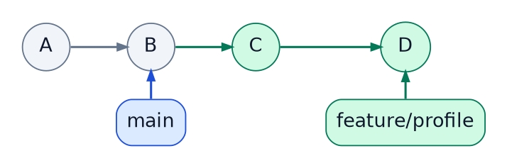

# 02 ブランチの操作

[← 01 基本操作](01-basic.md) ｜ [目次に戻る](../README.md#目次) ｜ [03 チーム開発 →](03-team.md)

> **目安：20〜30分（解説・操作確認）**  
> この章では、ブランチを作成し、切り替え、変更を記録してGitHubに公開するまでを学びます。Pull Requestや複数人でのマージは03章で扱います。

## 2-1. ブランチとは？

ブランチ（branch）は、**同じリポジトリの中で作業の流れを分ける仕組み**です。たとえば、動作しているプログラムを `main` に残しながら、新機能を別のブランチで開発できます。



A〜Dはコミットを表します。Bの時点で作業ブランチを作り、そこでCとDを記録すると、作業ブランチだけがDまで進みます。

- `main`：基準となるブランチ。チームで決めた安定版を置くことが多い
- `feature/...`：機能追加などの作業用ブランチ名の例
- **コミット**：変更を履歴として記録する操作

ブランチはファイルを丸ごと複製する機能ではなく、Gitがコミット履歴を参照して管理します。

## 2-2. 作業前の確認

01章で作った自分の練習用リポジトリ `git-practice` を使います。VSCodeでそのフォルダを開き、**ターミナル**（［ターミナル］→［新しいターミナル］）で以下を実行します。WindowsのPowerShellやGit Bashでも同じGitコマンドを使えます。

```bash
git status
git branch
```

`git status` に `nothing to commit, working tree clean` と表示されれば、作業を始められます。`git branch` はローカルのブランチ一覧を表示します。`*` が付いたブランチが現在の作業先です。

```text
* main
```

**注意：** ブランチ切り替え前に未コミットの変更があると、切り替えに失敗したり変更が引き継がれたりする場合があります。まず `git status` を確認し、必要ならコミットするか、作業を整理してください。

## 2-3. 新しいブランチを作成・切り替えする

今回は `feature/profile` というブランチを作ります。

```bash
git switch main
git switch -c feature/profile
```

- `git switch main`：`main` に切り替える
- `git switch -c feature/profile`：現在のコミットから新しいブランチを作り、そのブランチに切り替える

確認：

```bash
git branch
git status
```

```text
* feature/profile
  main
```

既存のブランチに切り替えるだけなら、`-c` を付けません。

```bash
git switch main
git switch feature/profile
```

> **補足：** 古い解説では `git checkout -b feature/profile` を使う場合があります。ブランチ作成・切り替えだけなら、目的が分かりやすい `git switch` をおすすめします。

## 2-4. 作業用ブランチでファイルを編集する

`feature/profile` に切り替えた状態で、VSCodeで `branch-note.md` を新規作成し、次のように入力して保存します。

```markdown
# ブランチの練習

- 興味のある技術：Python
- 学びたいこと：GitHubを使った共同開発
```

まず `git status` で `branch-note.md` だけが変更として表示されることを確認します。次に `git add .` を実行し、2回目の `git status` で `Changes to be committed` にそのファイルだけがあることを確かめてからコミットします。ほかに未ステージの変更がある場合は、`git add branch-note.md` で対象を指定できます。

```bash
git status
git add .
git status
git commit -m "Add branch practice note"
```

**ポイント：** コミットに成功すると `[feature/profile a1b2c3d]` のようにブランチ名と短いコミットIDが表示されます。コミットは、現在選んでいる `feature/profile` に記録されます。`main` に自動で反映されるわけではありません。

## 2-5. ブランチをGitHubにpushする

```bash
git push -u origin feature/profile
```

- `origin`：通常、clone元のGitHubリポジトリに付く名前
- `feature/profile`：pushするブランチ名
- `-u`：今後の `git push` / `git pull` で参照する上流ブランチを設定する

成功したらGitHubのリポジトリを開き、ブランチ選択メニューで `feature/profile` を選び、`branch-note.md` が表示されることを確認してください。

<!-- スクリーンショット挿入候補（実画面）: GitHubのブランチ選択メニューと、feature/profile に切り替えた後のファイル一覧。 -->

> **重要：** `push` はブランチをGitHubに送る操作です。**`main` に統合（merge）する操作ではありません。** 統合の方法は03章で説明します。

## 2-6. VSCodeからブランチを操作する

以下は、コマンドの代わりにVSCodeの画面で操作する場合の手順です。すでに作成・pushした場合は、ブランチ名をクリックして現在のブランチを確認するだけで構いません。

1. VSCodeでGitリポジトリを開く。
2. 画面左下などに表示される現在のブランチ名をクリックする（表示位置はバージョンやレイアウトによって異なります）。
3. **新しいブランチの作成**を選び、`feature/profile` のような名前を入力する。
4. ソース管理画面で変更ファイルを確認し、ステージング・コミットを行う。
5. **ブランチの発行（Publish Branch）** などからGitHubへ公開する。

操作項目が見つからない場合は、コマンドパレット（Windows: `Ctrl+Shift+P`）で `Git: Create Branch` や `Git: Checkout to` を検索してください。

## 2-7. mainとの違いを確認する

まず、作業ブランチのコミット履歴を確認します。

```bash
git log --oneline --graph --all --decorate -10
```

次に、ブランチ間の変更ファイルを比較します。

```bash
git diff --stat main..feature/profile
```

`main..feature/profile` は、`main` と `feature/profile` の差分を比較する指定です。`--stat` は変更ファイルと行数の概要を表示します。

`git diff --stat` の出力に `branch-note.md` があることを確認します。ここで `main` に切り替えると、作業ブランチで追加した `branch-note.md` はVSCodeのファイル一覧から消えます。もう一度作業ブランチに戻ると確認できます。

```bash
git switch main
git switch feature/profile
```

※ ブランチ間で共通のファイルや、未コミットの変更がある場合は見え方が異なります。

## 2-8. ブランチ名の付け方

Gitに決まった命名規則はありませんが、チームで統一すると管理しやすくなります。

| 例 | 用途 |
|---|---|
| `feature/login` | ログイン機能の追加 |
| `fix/header-layout` | ヘッダー表示の修正 |
| `docs/git-guide` | ドキュメント更新 |

日本語や曖昧な名前より、**作業内容が分かる短い名前**をおすすめします。

## 2-9. ブランチの削除（補足）

作業が完了し、必要な変更が統合された後は不要なブランチを整理できます。

```bash
git switch main
git branch -d feature/profile
```

`-d` は、上流ブランチが設定されていればそこへ、設定されていなければ現在のブランチへ、コミットが取り込まれていることを確認します。この例では上流を設定しているため、03章で `main` への取り込みを確認してから削除します。**この章ではまだマージしていないので、今は削除しないでください。**

GitHub側のブランチ削除は、統合後に03章で扱います。

## 2-10. よくあるエラーと対処

### `fatal: a branch named 'feature/profile' already exists`

同じ名前のローカルブランチが既にあります。新規作成せず、切り替えます。

```bash
git switch feature/profile
```

### `error: Your local changes ... would be overwritten by checkout`

切り替え先の内容と未コミットの変更が衝突する可能性があります。`git status` で変更を確認し、必要ならコミットしてから切り替えます。**安易に変更を破棄しないでください。**

### `error: src refspec ... does not match any`

指定したブランチ名が間違っている、またはコミットがない可能性があります。`git branch` と `git status` を確認してください。

### `Permission denied` / `Authentication failed`

GitHubへの認証に問題がある可能性があります。[事前準備資料](00-install.md)の認証方法を確認してください。

## 2-11. 理解度チェック

1. `main` とは別に作業用ブランチを作るメリットは何でしょうか？
2. `git switch -c feature/profile` と `git switch feature/profile` の違いは何でしょうか？
3. `git push -u origin feature/profile` を実行すると、GitHubの `main` に変更が統合されますか？
4. コミット前に `git status` を確認する理由は何でしょうか？

答えはこの章の各節を見返して考えてみてください。

## まとめ

- ブランチを使うと、`main` とは別の作業履歴を管理できる。
- `git switch -c` で作成と切り替え、`git switch` で切り替えを行う。
- 作業ブランチでも `add` → `commit` → `push` を使う。
- **pushしただけではmainにマージされない。** 次章でPull Requestとmergeを学ぶ。

---

## 演習問題

- [演習02：ブランチの操作](exercise/02-branch-exercise.md)
- [演習02：回答例・解説](exercise/answer/02.md)

---

## 参考資料（公式）

- [Git公式：ブランチの概要](https://git-scm.com/book/ja/v2/Git-のブランチ機能-ブランチとは)
- [Git公式：git switch](https://git-scm.com/docs/git-switch)
- [GitHub Docs：ブランチについて](https://docs.github.com/ja/pull-requests/collaborating-with-pull-requests/proposing-changes-to-your-work-with-pull-requests/about-branches)
- [VSCode公式：ソース管理](https://code.visualstudio.com/docs/sourcecontrol/overview)

---

[← 01 基本操作](01-basic.md) ｜ [目次に戻る](../README.md#目次) ｜ [03 チーム開発 →](03-team.md)
