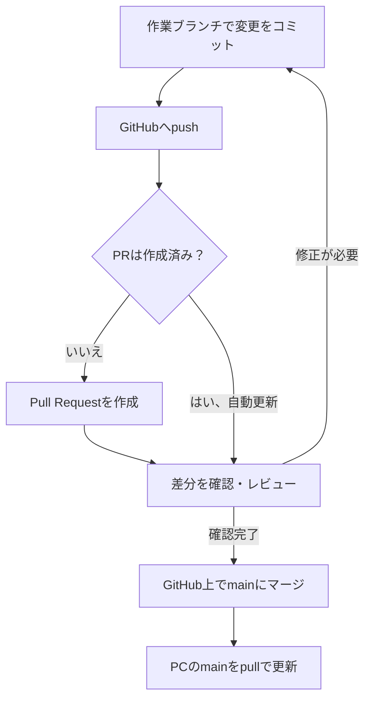
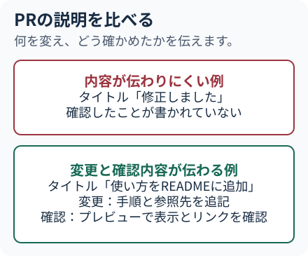

# 03 チーム開発の基本：Pull Request・レビュー・マージ

[← 02 ブランチの操作](02-branch.md) ｜ [目次に戻る](../README.md#目次) ｜ [04 エラー・コンフリクト対処 →](04-troubleshooting.md)

> **この章の目標**：作業ブランチで変更を作り、GitHub上でPull Request（PR）を提出し、レビューを経て `main` に反映できるようになる。
>
> **前提**：01章の `clone`・`commit`・`push`、02章のブランチ作成・切り替えを理解していること。
>
> **想定時間**：説明と操作確認で20〜30分程度。

## 3-1. チーム開発でブランチを使う理由

複数人が同じ `main` ブランチを直接編集すると、作業の途中で他人の変更が入り、確認不足や競合が起こりやすくなります。そこで、通常は担当作業ごとにブランチを作成し、完成した変更を **Pull Request** で提案します。



**用語**

| 用語 | 意味 |
|---|---|
| `main` | チームの基準となるブランチ |
| 作業ブランチ | 機能追加・修正を独立して進めるブランチ |
| Pull Request（PR） | あるブランチの変更を別のブランチに取り込む提案 |
| レビュー | 変更内容を他のメンバーが確認すること |
| merge | 変更を別のブランチへ統合すること |
| conflict（競合） | Gitが変更を自動的に統合できない状態 |

※ PRはGitHubの機能です。`git merge` はGit自体のコマンドで、PRを作らなくても実行できます。ただしチーム開発ではPRを利用すると変更内容や議論が残ります。

## 3-2. チームで決めておきたいルール

最初は複雑なルールを作らず、次の4点を共有するだけでも効果があります。

1. 原則として `main` に直接pushせず、作業ブランチを作る。
2. 変更は小さな単位でcommitする。
3. PRには「何を変更したか」「どう確認したか」を書く。
4. PRをマージする前に、少なくとも変更差分を確認する。

例：ブランチ名 `feature/add-janken`、`fix/readme-typo`、`docs/setup-guide`。

## 3-3. 作業ブランチで変更を作る

01章で使った自分の練習用リポジトリ `git-practice` で試せます。複数人で練習する場合は、対象リポジトリへのアクセス権と、誰がレビュー・マージするかを確認しておきます。

[02章の演習](exercise/02-branch-exercise.md)で `feature/branch-practice` をpush済みなら、そのブランチを使って3-4から始められます。その場合は、以降のブランチ名を `feature/branch-practice`、ファイル名を `branch-practice.md` に読み替えます。

### ① 最新のmainを取得する

VSCodeのターミナル、Git Bash、PowerShellなどで、対象リポジトリのフォルダを開きます。

```bash
git status
```

`nothing to commit, working tree clean` を確認してから、次の2行を実行します。

```bash
git switch main
git pull --ff-only
```

01章の手順でクローンした練習用リポジトリでは、`git pull` でGitHub上の同じブランチから変更を取り込めます。`--ff-only` を付けると履歴が分岐している場合に止まります。エラーが出たら、作業ブランチを作る前に[04章](04-troubleshooting.md)を確認します。

### ② 作業ブランチを作成する

```bash
git switch -c docs/add-team-note
```

`-c` は「新しいブランチを作って、そのブランチへ切り替える」という意味です。

### ③ ファイルを編集してcommitする

例えば `team-note.md` を新規作成し、次の内容を書きます。

```markdown
# チーム開発メモ

- 変更を送る前に、作業ブランチと差分を確認する。
```

その後、変更を確認してコミットします。

```bash
git status
git add team-note.md
git status
git commit -m "Add team development note"
```

最初の `git status` では `Untracked files` に `team-note.md` が表示されます。2回目は `Changes to be committed` に今回のファイルだけが表示されていることを確認してからコミットします。行単位で確認したいときは `git diff --staged` を使えます。

### ④ GitHubへブランチをpushする

```bash
git push -u origin docs/add-team-note
```

`-u` を付けると追跡先が設定され、次回以降は同じブランチで `git push` と省略しやすくなります。

## 3-4. Pull Requestを作成する（GitHubブラウザ）

1. GitHubで対象リポジトリを開く。
2. push後に表示される **Compare & pull request** を押す。表示されない場合は **Pull requests → New pull request** を選ぶ。
3. **base: `main`**（取り込み先）、**compare: `docs/add-team-note`**（変更元）になっているか確認する。
4. 差分に意図したファイルだけが含まれていることを確認し、タイトルと説明を入力する。
5. **Create pull request** をクリックする。作成後にPR番号（例：`#1`）と **Open** が表示されたことを確認する。

<!-- スクリーンショット挿入候補（実画面）: PR作成画面のbase・compareと差分。 -->

**PR説明の例**

```markdown
## 変更内容
- team-note.md を追加しました

## 確認したこと
- ファイルが正しく表示されることを確認しました

## 補足
- 初回の共同開発練習です
```



**重要**：`base` と `compare` を逆にすると、意図しない変更を提案する可能性があります。作成前に必ず確認しましょう。

## 3-5. レビューで何を確認する？

PRの **Files changed** タブで、追加・削除・変更された行を確認できます。

- 目的に合った変更か
- 不要なファイルや秘密情報が含まれていないか
- 読みやすいコード・説明になっているか
- 既存の機能を壊していないか
- 動作確認の方法が書かれているか

複数人で練習する場合は、PR画面の **Reviewers** からレビュー担当者を選びます。依頼できる相手や承認の要否はリポジトリの権限・設定によって異なります。

レビュー担当者は **Files changed** で差分を確認し、気になる行にコメントを付けられます。**Review changes** から、状況に応じて **Comment**（意見を伝える）、**Approve**（承認）、**Request changes**（修正を依頼）を選び、**Submit review** で送信します。個人練習では、差分を自分で確認してからマージへ進みます。承認が必須の設定では、承認できる別のメンバーに依頼してください。

<!-- スクリーンショット挿入候補（実画面）: Files changedとReview changesのメニュー。 -->

### 指摘を受けたら

PRを閉じて作り直す必要はありません。**同じ作業ブランチ**で修正してpushすると、PRに変更が追加されます。

```bash
git switch docs/add-team-note
# ファイルを修正する
git add team-note.md
git commit -m "Revise team development note"
git push
```

## 3-6. Pull Requestをマージする

レビュー・動作確認が終わったら、権限を持つメンバーがPR画面から **Merge pull request** などを選択します。

GitHubには代表的に次の統合方法があります。利用できる方法はリポジトリ設定によって異なります。

| 方法 | 特徴 | 初心者向けの考え方 |
|---|---|---|
| Create a merge commit | ブランチの統合を履歴に残す | まずはこれを理解するとよい |
| Squash and merge | 複数コミットを1つにまとめて統合 | 細かい作業履歴を整理したい場合 |
| Rebase and merge | コミットを並べ直して統合 | 履歴の仕組みを理解してから扱う |

マージ方法を選び、確認画面で **Confirm merge** などを押します。PRが **Merged** になったことを確認し、GitHub上の `main` に切り替えて対象のファイルを開きます。作業ブランチは不要になったら削除できます。

## 3-7. ローカルのmainを最新にする

**GitHub上でPRをマージしても、自分のPCの `main` は自動では更新されません。**

```bash
git switch main
git pull --ff-only
git log --oneline -5
```

`Fast-forward` と表示されれば、ローカルの `main` が進んでいます。`Already up to date.` の場合は取り込む更新がありません。VSCodeでマージしたファイルを開き、内容を確認します。

作業ブランチが不要で、変更が統合済みであることを確認できたら、ローカル側も削除できます。

```bash
git branch -d docs/add-team-note
```

`-d` は上流ブランチ（設定がなければ現在のブランチ）への取り込みを確認します。実行前に、PRが **Merged** であること、`main` に必要な変更があること、作業ブランチに残したい追加コミットがないことを確認してください。SquashやRebaseでマージした場合はコミットIDが変わり、状況によっては削除を拒否されます。その場合はブランチを残して構いません。GitHub上のブランチ削除は別操作です。

## 3-8. 複数人で作業するときの例

例：3人でPythonのじゃんけんゲームを作る場合。

| 担当 | ブランチ | 主な作業 |
|---|---|---|
| Aさん | `feature/janken-rule` | 勝敗判定 |
| Bさん | `feature/janken-ui` | 入出力メッセージ |
| Cさん | `docs/janken-guide` | READMEの説明 |

各自が別ブランチで作業し、PRを提出します。**別ブランチでも同じファイルの同じ行を変更すると競合することがあります。** 担当を分けるだけでなく、変更箇所の共有も大切です。

### 作業を分ける前に、仕様とマージ順を決める

たとえば、Aさんが勝敗を数字で返すつもりで、Bさんが「勝ち」「負け」「あいこ」という文字列を受け取るつもりだと、別々のファイルで作業しても、組み合わせたときに動きません。作業前に、勝敗判定が何を受け取り、何を返すかを決めておきます。

1. **Issueで完了条件をそろえる。** 「勝敗判定は `win`、`lose`、`draw` のいずれかを返す」「画面は結果を日本語で表示する」と書き、担当と確認方法も共有します。[Issueの使い方](06-features.md#6-2-github-issuesタスクバグを管理する)
2. **依存するPRは順番を決める。** Bさんは表示文の準備を並行して進められます。Aさんの判定処理を先にマージし、Bさんは最新の `main` を自分の作業ブランチに取り込んで、判定と表示を組み合わせて確認します。PRの説明に「判定処理のPR #12 のマージ待ち」と書くと、レビュー担当者にも順序が伝わります。
3. **レビューで再現できる確認方法を書く。** 「動作確認済み」に加えて、「プレイヤーがグー、相手がチョキなら『勝ち』と表示される。負けとあいこも確認した」のように、入力と期待する結果を残します。

**考えてみよう**　実装途中で `draw` を `tie` に変える案が出ました。誰に何を共有し、どのPRやテストを更新すれば、マージ後も正しく動くでしょうか。

## 3-9. よくあるトラブル

### Q1. `Compare & pull request` が表示されない

**Pull requests → New pull request** から、取り込み先（base）と変更元（compare）を選んでください。ブランチがGitHubにpush済みかも確認します。

### Q2. `main` に直接commitしてしまった

まだpushしていない場合と、すでにpushした場合で対処が異なります。慌てて `reset --hard` や強制pushを実行せず、まず `git status` と `git log --oneline -5` で状態を確認してください。

### Q3. `git push` が拒否された

リモートに新しい変更がある、権限がない、保護ルールがあるなど複数の原因が考えられます。エラーメッセージを確認してください。**`--force` で無理に上書きしないこと。**

### Q4. PRに「This branch has conflicts」と表示された

取り込み先と変更元で競合する変更があります。競合の解消方法は [04 エラー・コンフリクト対処](04-troubleshooting.md) で扱います。競合のあるPRは、そのままマージできない場合があります。

### Q5. PRのレビューが終わらない

変更範囲が大きすぎないか、説明が不足していないかを確認しましょう。小さく目的が明確なPRほど確認しやすくなります。

### Q6. マージボタンが押せない

PR画面に表示される理由を確認します。追加の承認、テストの成功、競合の解消、マージ権限が必要な場合があります。Draftの場合は、レビューに出せる状態になってから **Ready for review** を選びます。

## 3-10. 理解度チェック

1. なぜ `main` に直接pushせず作業ブランチを使うのでしょうか？
2. PRの `base` と `compare` はそれぞれ何を表しますか？
3. PRの指摘を修正した場合、新しいPRを作る必要はありますか？
4. GitHubでマージした後、PCの `main` を更新するには何をしますか？
5. 別ブランチで作業していても競合が起こるのはどんな場合でしょうか？

<details>
<summary>解答例を見る</summary>

1. 他人の作業や安定したコードへの影響を抑え、変更を確認してから統合するため。
2. `base` は取り込み先、`compare` は変更元。
3. 通常は不要。同じブランチで修正・pushすればPRが更新される。
4. `git switch main` → `git pull --ff-only`。
5. 同じファイルの同じ箇所などを双方が変更し、Gitが自動統合できない場合。

</details>

---

## 演習問題

- [演習03：チーム開発](exercise/03-team-exercise.md)
- [演習03：回答例・解説](exercise/answer/03.md)

---

## 参考資料（公式）

- [GitHub Docs：Pull Requestについて](https://docs.github.com/ja/pull-requests/collaborating-with-pull-requests/proposing-changes-to-your-work-with-pull-requests/about-pull-requests)
- [GitHub Docs：Pull Requestを作成する](https://docs.github.com/ja/pull-requests/collaborating-with-pull-requests/proposing-changes-to-your-work-with-pull-requests/creating-a-pull-request)
- [GitHub Docs：Pull Requestをマージする](https://docs.github.com/ja/pull-requests/collaborating-with-pull-requests/incorporating-changes-from-a-pull-request/merging-a-pull-request)
- [Git公式ドキュメント：ブランチとマージ](https://git-scm.com/book/ja/v2/Git-%E3%81%AE%E3%83%96%E3%83%A9%E3%83%B3%E3%83%81%E6%A9%9F%E8%83%BD-%E3%83%96%E3%83%A9%E3%83%B3%E3%83%81%E3%81%A8%E3%83%9E%E3%83%BC%E3%82%B8%E3%81%AE%E5%9F%BA%E6%9C%AC)

---

[← 02 ブランチの操作](02-branch.md) ｜ [目次に戻る](../README.md#目次) ｜ [04 エラー・コンフリクト対処 →](04-troubleshooting.md)
