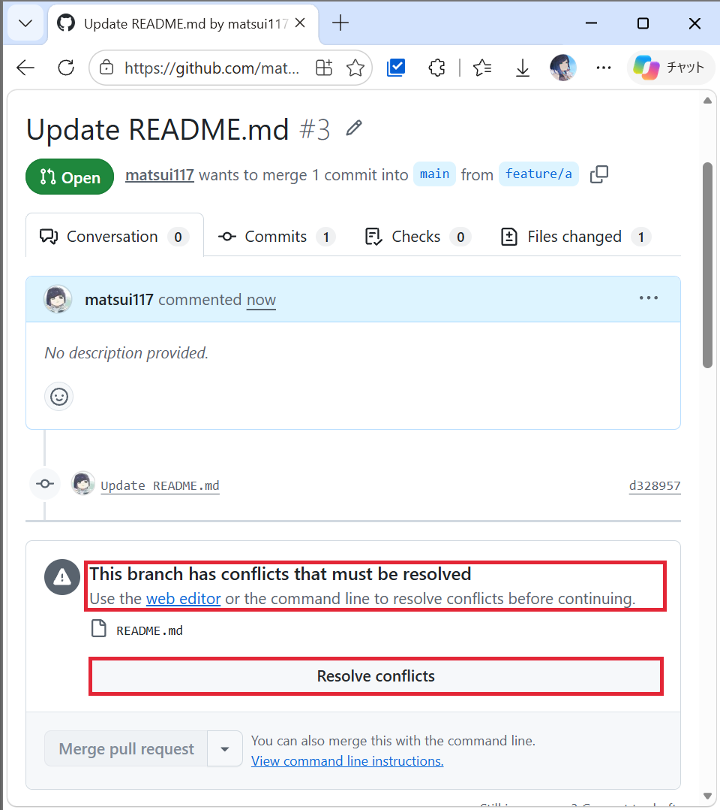
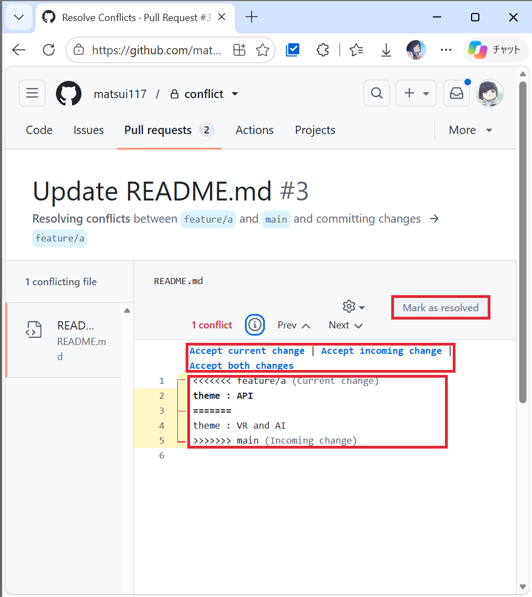
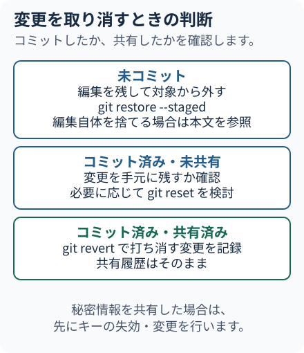

# 04 エラー・コンフリクト対処と変更の取り消し

[← 03 チーム開発](03-team.md) ｜ [目次に戻る](../README.md#目次) ｜ [05 便利なGitコマンド・小技 →](05-tips.md)

> **対象**：01〜03章を終え、`add`・`commit`・`push`・`pull`・ブランチ・Pull Requestの基本を知っている人  
> **目標**：エラーが出たときに状態を確認し、他の人の作業を消さずに復旧できるようになる。

## 4-1. 最初に確認すること

エラーが出たら、慌てて `reset --hard` や `push --force` を実行しないでください。まず次のコマンドで状況を調べます。

```bash
git status
git branch
git log --oneline
git remote -v
```

| コマンド | 確認できること |
|---|---|
| `git status` | 変更中のファイル、競合、rebase中かどうか |
| `git branch` | ローカルのブランチ一覧。通常は `*` が現在のブランチを示します。rebase中はブランチ名の代わりに作業中の状態が表示されることがあります |
| `git log --oneline` | 現在の位置からたどれるコミット履歴を1件1行で表示 |
| `git remote -v` | push先のリポジトリURL |

必要に応じて `git fetch origin` でリモートの情報を更新し、`git log --oneline --graph --all` でローカルとリモートの履歴を見比べます。上の `git log --oneline` に `--graph` を加えると分岐・合流が線で見え、`--all` を加えると現在のブランチ以外の履歴も確認できます。[05章の履歴確認](05-tips.md#5-4-コミット履歴を見やすくするgit-log)も参照してください。`fetch` は通常、作業ファイルを直接変更しません。

## 4-2. pushが拒否された（non-fast-forward）

### 例

```text
! [rejected] main -> main (non-fast-forward)
error: failed to push some refs
```

**原因**：GitHub上の `main` に、ローカルにまだないコミットが存在するなど、単純にpushすると履歴が食い違う状態です。誰かが先にpushしたときによく起こります。

### 対処

1. `git status` で未コミットの変更がないことを確認します。変更があるなら先にコミットするか、必要に応じて退避します。
2. `git fetch origin` でGitHub側の情報を更新し、`git status` で現在のブランチと追跡先を確認します。
3. 以下は**自分専用の練習リポジトリ**で、`main` にまだ送っていない自分のコミットがある場合の例です。共同開発では、`main` に直接pushせず、作業ブランチとPRを使います。

```bash
git switch main
git pull --rebase origin main
```

4. 取り込みが成功したら、次を実行します。競合で止まったら4-3へ進みます。

```bash
git push origin main
```

> **注意**：`--rebase` を付けると、手元だけにあるコミットを取得した履歴の上に積み直すため、取り込み用のマージコミットを作らずに済みます。省略すると統合方法は設定などに従い、分岐時にマージする、rebaseする、停止するなど動作が変わります。[07章のrebase](07-advanced.md#7-2-git-rebaseブランチの起点を移動する)も参照してください。共同作業者が利用する共有ブランチの履歴を安易に書き換えないでください。作業方針が決まっているチームではそれに従います。merge方式を明示する場合は `git pull --no-rebase origin main` を使います。

## 4-3. コンフリクト（競合）が起きた

### どんなときに起きる？

同じファイルの近い行を別々に変更し、Gitが自動的に統合できないときです。例えば、2人が `README.md` の同じ見出しを書き換えた場合です。

`git status` で競合したファイルを確認します。以下はrebase中にREADMEが競合したときの表示例です。

```text
<<<<<<< HEAD
GitHub側の説明
=======
自分が追加した説明
>>>>>>> コミット名など
```

`<<<<<<<`、`=======`、`>>>>>>>` は**説明用の区切り記号**であり、そのまま残してはいけません。双方の内容を確認し、必要な文章を残して保存します。VSCodeのマージエディタで解決しても構いません。

### `pull --rebase` 中の解決手順

```bash
git status
# 競合ファイルをVSCode等で修正して保存
git add README.md
git rebase --continue
```

さらに競合が出たら同じ手順を繰り返します。途中でコミットメッセージの編集画面が開いた場合は、保存して閉じると続行します。

- **Vim**：`Esc` → `:wq` → Enter
- **VSCode**：`Ctrl + S`（Macは `Command + S`）で保存し、コミットメッセージのタブを閉じる

最初からやり直したい場合は、状況を確認したうえで `git rebase --abort` を使います。**rebase中は `git merge --continue` ではなく `git rebase --continue`** です。

### merge中の場合

```bash
git status
# ファイルを修正して保存
git add README.md
git merge --continue
```

競合解消後は `git status` で状態を確認し、必要に応じてpushします。マージを中止する場合は `git merge --abort` を使います。

> **重要**：rebase中の `HEAD` やVSCodeの「Current / Incoming」の意味は、通常のmergeと直感的に異なることがあります。ラベルだけで判断せず、実際の変更内容を比較してください。

### GitHubのブラウザでPRの競合を解消する

PRの下部に競合の警告が出たら、**Resolve conflicts** を押して競合エディタを開きます。ブラウザで解消できるのは、同じ行を別々に変更した場合などの単純な競合です。ボタンが無効な場合は、この節のローカルでの手順を使います。

<a href="../images/screenshots/04-conflict-01-warning.png"></a>

競合しているファイルを選び、2つの変更を見比べます。下の画像では作業ブランチ `feature/a` が **Current change**、取り込み先の `main` が **Incoming change** です。ローカルでのmergeやrebaseではラベルが指す側が変わることがあるため、名前だけで判断せず、競合マーカーに表示されたブランチ名や変更内容を確認します。

<a href="../images/screenshots/04-conflict-02-editor.png"></a>

| 操作 | 競合箇所に残す内容 |
|---|---|
| **Accept current change** | Current側だけを残します。画像では `feature/a` の `theme : API` です。 |
| **Accept incoming change** | Incoming側だけを残します。画像では `main` の `theme : VR and AI` です。 |
| **Accept both changes** | 両側の内容をそのまま残します。画像では `theme` で始まる行が2行残ります。 |

**Accept both changes** を選んだ後も、同じ設定が重複したり、内容が矛盾したりしていないか確認します。手動で統合する場合は、エディタで必要な内容を書き直し、`<<<<<<<`・`=======`・`>>>>>>>` の行を取り除きます。たとえば両方のテーマを1行にまとめる仕様なら、競合部分を `theme : API, VR and AI` の1行にします。

1. そのファイルの競合をすべて解消したら **Mark as resolved** を押し、解消済みとします。ほかのファイルでも同じように確認します。
2. 全ファイルが解消済みになったら **Commit merge** を押します。この操作で、解消内容と取り込み先（base）の変更がPRの作業ブランチ（head）に記録されます。その後、PR画面で競合の警告が消えたことと、**Files changed** やテスト結果を確認し、通常のPRの手順で取り込みます。

[GitHub公式：ブラウザで競合を解消する](https://docs.github.com/en/pull-requests/how-tos/merge-and-close-pull-requests/resolving-a-merge-conflict-on-github)

## 4-4. 間違えて `main` にpushしてしまった！



**最重要ポイント：push済みのコミットは、原則 `git revert` で打ち消します。** 共有履歴を消す `git reset --hard` ＋ `git push --force` は、他の人の作業を壊す危険があるため、初心者向けの復旧方法として使いません。

### ケースA：pushした内容に問題があるので取り消したい

まず、何を取り消すのか確認します。

```bash
git switch main
git pull --ff-only origin main
git log --oneline
```

`--ff-only` を付けると、履歴が分岐している場合はマージせずに止まります。取り消したいコミットが通常のコミット1件なら、該当するコミットIDを指定して取り消しコミットを作ります。以下のpushは自分専用の練習用リポジトリの例です。共有リポジトリでは、最新の `main` から作業ブランチを作り、そこでrevertしてPRで提案します。

```bash
git revert <コミットID>
git push origin main
```

例：

```bash
git revert a1b2c3d
git push origin main
```

`revert` は過去のコミットそのものを削除せず、**変更を打ち消す新しいコミット**を作ります。途中で競合した場合は `git status` を確認し、修正・`git add` の後に `git revert --continue` を実行します。中止する場合は `git revert --abort` です。

**注意**：複数コミットを戻す場合や、Pull Requestをマージした「マージコミット」を取り消す場合は手順が異なります。マージコミットには親の指定（`-m`）が必要になることがあるため、履歴を確認してチームで相談してください。

### ケースB：変更内容は正しいが、mainではなく作業ブランチで管理したかった

**無理に履歴を消す必要はありません。** すでに共有された `main` の変更をそのまま残し、次の作業からブランチを使うのが最も安全です。

```bash
git switch main
git pull --ff-only origin main
git switch -c feature/next-task
```

もしチームのルール上、mainから変更を除いてPRで改めて入れ直す必要があるなら、勝手に作業せず管理者・メンバーと相談します。`revert` してから同じ変更を再適用するには追加の操作が必要で、単純にPRを作るだけでは元の変更を再導入できない場合があります。

### ケースC：mainにpushしたのは機密情報（APIキー・パスワードなど）

**通常の `revert` だけでは不十分です。** 履歴に秘密情報が残るため、直ちにそのキー・パスワードを失効・変更し、リポジトリ管理者に連絡してください。必要に応じてGitHub公式手順に沿って履歴から機密情報を除去します。公開範囲をPrivateに変更するだけでは、すでに漏れた情報を回収できません。

失効・再発行の順序や影響の調べ方は、[08章の漏えい時の対応](08-security.md#8-5-秘密情報をコミットpushしてしまったら)を参照してください。

### `revert` と `reset` の違い

| コマンド | 何をする？ | 共有mainでの扱い |
|---|---|---|
| `git revert <ID>` | 変更を打ち消す新しいコミットを作る | **原則こちら** |
| `git reset --soft HEAD~1` | ローカルのコミット位置を戻し、変更はステージ済みにする | push済みの履歴修正には安易に使わない |
| `git reset --hard ...` | ローカルの変更も破棄し得る | **初心者は復旧目的で使わない** |
| `git push --force` | リモート履歴を強制的に書き換える | **共有mainでは避ける** |

## 4-5. まだpushしていない変更を間違えた

### ファイルの変更を取り消したい（未ステージ）

```bash
git status
git diff
git restore <ファイル名>
```

この `git restore` は追跡済みファイルの作業内容をステージにある内容に戻します。指定したファイルの**未ステージの変更は失われる**ので、`git diff` で確認してから実行してください。

### `git add` しただけならステージから外す

```bash
git restore --staged <ファイル名>
```

`--staged` はステージだけを操作する指定です。作業ファイルを残して次のコミットから外したいときに使います。省くと上の例のように作業ファイルに反映されます。

### 直前のコミットメッセージを直したい（まだpushしていない場合）

```bash
git commit --amend -m "修正したメッセージ"
```

メッセージだけ直す場合は、`git status` でステージ済みの変更がないことを先に確認します。`--amend` は直前のコミットを置き換え、コミットIDも変わります。省くと、通常はステージした変更を新しいコミットとして履歴の末尾に追加します。**すでにpushした共有コミットには安易に使わない**でください。

## 4-6. 作業途中でpull・ブランチ切り替えができない

```text
error: Your local changes to the following files would be overwritten
```

これは、未コミットの変更が上書きされる可能性があるためGitが操作を止めている状態です。

**対処の選択肢**：

1. 作業がまとまっていればコミットする
2. 一時的に退避するなら `git stash`
3. 退避後に操作し、`git stash pop` で変更を戻す（競合することもあります）

```bash
git status
git stash
git stash list
```

`Saved working directory and index state` と表示されれば退避できています。`No local changes to save` と出た場合は今回の退避がないため、あとで `git stash pop` を実行しないでください。

現在のブランチが `main` で、GitHub上の `main` を取り込む場合は、次を実行します。作業ブランチにいる場合は、まず取り込みたいブランチを確認してください。

```bash
git pull --ff-only origin main
```

pullが成功し、`git stash list` の先頭が今回の退避であることを確認してから戻します。

```bash
git stash pop
```

> `stash` は通常、追跡対象の変更を退避します。新規の未追跡ファイルも含めたい場合は `git stash push -u` を使います。退避前後に `git status` を確認してください。

## 4-7. よくあるエラー早見表

| メッセージ | 主な原因 | 最初の確認 |
|---|---|---|
| `non-fast-forward` | リモートに新しい履歴がある | `git fetch` と `git status` |
| `CONFLICT (content)` | 同じ箇所を別々に変更 | `git status`、競合ファイル |
| `Permission denied (publickey)` | SSH鍵の認証に失敗 | SSH設定、公開鍵の登録 |
| `Authentication failed` | HTTPS認証に失敗 | 認証方法、ログイン状態 |
| `Author identity unknown` | Gitの名前・メール未設定 | `git config --global --list` でユーザー共通設定を一覧表示。個別に確認する手順は[事前準備資料](00-install.md#5-3-設定を確認する)へ |
| `not a git repository` | リポジトリ外で実行 | 現在のフォルダ、`cd` |
| `nothing to commit` | コミット対象の変更がない | `git status` |
| `rebase in progress` | rebaseが途中 | `git status`、`--continue` / `--abort` |

## 4-8. トラブルを防ぐための運用ルール

- 共同開発では、原則 `main` に直接pushせず、作業ブランチとPull Requestを使う
- 作業開始前に `git status` と `git pull` で状態を確認する
- 変更は小さな単位でコミットする
- `.env`、APIキー、パスワードなどをコミットしない
- `--force`、`reset --hard`、履歴の書き換えは意味を理解するまで使わない
- 可能ならGitHubのブランチ保護ルール／rulesetでmainへの直接pushを制限する（権限・プランにより設定可能範囲が異なる）

## 4-9. 理解度チェック

1. `push` が拒否されたとき、いきなり `--force` を使わないのはなぜ？
2. `pull --rebase` の途中で競合したら、ファイル修正後にどのコマンドを使う？
3. 誤って共有mainにpushした通常のコミットを安全に打ち消すコマンドは？
4. `git restore --staged` と `git restore` の違いは？
5. APIキーをpushしてしまった場合、`revert` だけで十分？

---

## 演習問題

- [演習04：エラー・コンフリクト対処](exercise/04-troubleshooting-exercise.md)
- [演習04：回答例・解説](exercise/answer/04.md)

---

## 参考資料（公式）

- [GitHub Docs：マージコンフリクトについて](https://docs.github.com/ja/pull-requests/collaborating-with-pull-requests/addressing-merge-conflicts/about-merge-conflicts)
- [GitHub Docs：機密情報をリポジトリから削除する](https://docs.github.com/ja/authentication/keeping-your-account-and-data-secure/removing-sensitive-data-from-a-repository)
- [Git公式：git-revert](https://git-scm.com/docs/git-revert)
- [Git公式：git-rebase](https://git-scm.com/docs/git-rebase)
- [Git公式：git-restore](https://git-scm.com/docs/git-restore)
- [Git公式：git-stash](https://git-scm.com/docs/git-stash)

---

[← 03 チーム開発](03-team.md) ｜ [目次に戻る](../README.md#目次) ｜ [05 便利なGitコマンド・小技 →](05-tips.md)
