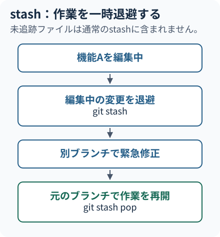

# 05 便利なGitコマンド・小技

[← 04 エラー・コンフリクト対処](04-troubleshooting.md) ｜ [目次に戻る](../README.md#目次) ｜ [06 GitHubの便利な機能 →](06-features.md)

> **対象**：01〜04章の基本操作を学んだ人  
> **目安**：20〜30分（読むだけなら約15分）  
> **到達目標**：変更を確認し、必要なファイルだけコミットし、一時退避や安全な取り消しができる。

この章では、Gitを日常的に使うときに役立つコマンドを紹介します。全部暗記する必要はありません。困ったときに参照できるようにしておきましょう。

## 5-1. 作業前に状態を確認する：`git status`

```bash
git status
```

現在のブランチ、変更されたファイル、ステージ済みのファイルなどを確認できます。**何か操作する前にまず `git status`** を実行する習慣をつけましょう。

短く表示したい場合：

```bash
git status -sb
```

先頭2列は、左がステージ済み、右が未ステージの状態です。`M ` はステージ済みの変更、` M` は未ステージの変更、`MM` は両方に変更がある状態、`??` は未追跡ファイルを表します。迷ったら通常の `git status` で確認してください。

## 5-2. 変更箇所を確認する：`git diff`

```bash
git diff
```

追跡済みファイルの未ステージの変更を表示します。新しく作った未追跡ファイルは `git status` で確認します。

```bash
git diff --staged
```

`git add` 済みで、次のコミットに含まれる変更を表示します。**コミット前に `git diff --staged` を見る**と、意図しない変更を防げます。

特定のファイルだけ確認する場合：

```bash
git diff -- README.md
```

## 5-3. 必要なファイルだけコミットする：`git add`

```bash
git add README.md
```

指定したファイルだけステージします。

```bash
git add -p
```

追跡済みファイルの変更を、Gitが区切った差分のまとまり（hunk）ごとにステージできます。`y` は追加、`n` は見送り、`q` は終了です。

`git add .` は便利ですが、不要なファイルまで含めないよう `git status` で確認してください。

## 5-4. コミット履歴を見やすくする：`git log`

```bash
git log --oneline
```

コミット履歴を1行ずつ表示します。

```bash
git log --oneline --graph --decorate --all
```

ブランチの分岐・合流を図のように表示します。チーム開発の状況確認に便利です。

現在のコミット（`HEAD`）で変更したファイルと行数の概要を見る場合：

```bash
git show --stat HEAD
```

## 5-5. 作業を一時退避する：`git stash`

まだコミットしたくない変更がある状態で、別の作業をしたいときに使います。



```bash
git stash push -m "README編集中"
```

退避した内容の一覧：

```bash
git stash list
```

一覧の先頭に今回の退避があることを確認してから戻します。新しい退避ができていなければ、ここで止めます。

```bash
git stash pop
```

`pop` は適用に成功するとstashの記録を削除します。記録を残して適用したい場合は `git stash apply` を使います。競合で `pop` が止まった場合は退避の記録が残ります。`git status` で状態を確認し、同じ退避を繰り返し適用する前に競合を解消します。

**注意：** 通常の `git stash` は未追跡ファイルを含みません。未追跡ファイルも退避したい場合は `git stash push -u -m "作業途中"` を使います。機密ファイルを安易に退避・共有しないでください。

## 5-6. 不要なファイルを除外する：`.gitignore`

Pythonプロジェクトでは、生成物やローカル環境のファイルをGitの管理対象から除外できます。

プロジェクトのルートに `.gitignore` を作り、例として次を記述します。

```gitignore
__pycache__/
*.pyc
.venv/
.env
.vscode/
```

**重要：** `.gitignore` は、すでにGitで追跡しているファイルにはそのままでは効きません。また、`.env` を除外しても秘密情報の流出を完全には防げません。APIキーやパスワードをコミットしないことが大前提です。

追跡済みファイルを作業PCに残したまま追跡対象から外す例：

```bash
git rm --cached .env
```

作業中のPCにはファイルが残り、次のコミットで追跡対象から外れます。`.gitignore` の変更も同じコミットに含めます。共有済みの秘密情報は、まず失効・再発行してください。

## 5-7. 変更を安全に戻す：`git restore`

**ステージだけ取り消す**（作業内容は残る）：

```bash
git restore --staged README.md
```

**追跡済みファイルの未ステージの変更を破棄する**：

```bash
git restore README.md
```

後者は作業フォルダの内容をステージ済みの内容に戻します。未ステージの変更が失われるため、実行前に `git diff -- README.md` で対象を確認してください。新しく作った未追跡ファイルは、このコマンドでは削除されません。

すでに共有したコミットを取り消す場合は、04章で扱った `git revert` を優先します。

## 5-8. GitHubで役立つ小技

### Pull Requestのレビューをしやすくする

- PRは変更目的が1つになるように分ける
- タイトルに「何を変更したか」を書く
- 説明欄に目的・変更内容・確認方法を書く
- レビュー前に差分（Files changed）を確認する

### READMEを見やすくする

Markdownの見出しや相対リンクを使うと、教材の目次を作れます。

```markdown
[01 基本操作](01-basic.md)
[演習01](exercise/01-basic-exercise.md)
```

上記のリンクは、`docs/` 内のMarkdownファイルから書く場合の例です。リポジトリ直下の `README.md` からリンクする場合は `docs/01-basic.md` と指定します。

### コマンド入力を少し楽にする

ターミナルでは上矢印キーで過去のコマンドを呼び出せます。長いコマンドを再入力するときに便利です。ただし、以前のコマンドをそのまま実行してよいか確認しましょう。

## 5-9. よくある場面と使うコマンド

| 状況 | コマンド | 注意点 |
|---|---|---|
| 何が変更されたか知りたい | `git status` | まずこれを確認 |
| 編集内容を確認したい | `git diff` | ステージ前の差分 |
| コミット予定を確認したい | `git diff --staged` | ステージ後の差分 |
| 履歴を一覧したい | `git log --oneline` | `--graph --all` も便利 |
| 一時的に作業を避けたい | `git stash` | 未追跡ファイルに注意 |
| ステージを取り消したい | `git restore --staged ファイル名` | 編集内容は残る |
| 未ステージの変更を破棄したい | `git restore ファイル名` | 元に戻せない場合がある |

## 5-10. 理解度チェック

1. `git diff` と `git diff --staged` の違いは何でしょうか？
2. `git add .` を使う前に確認した方がよいことは何でしょうか？
3. `git stash` を実行したとき、通常は未追跡ファイルも退避されるでしょうか？
4. `git restore --staged README.md` はREADMEの編集内容を消すでしょうか？
5. `.gitignore` に追記すれば、過去にコミットしたAPIキーも安全になるでしょうか？

<details>
<summary>解答を表示</summary>

1. 前者は未ステージの差分、後者はステージ済みの差分。
2. 不要なファイルや秘密情報が含まれていないか `git status` などで確認する。
3. いいえ。未追跡ファイルを含めるには `-u` が必要。
4. いいえ。ステージを外すだけで編集内容は残る。
5. いいえ。公開済みの秘密情報は失効・再発行などの対応が必要。

</details>

---

## 演習問題

- [演習05：便利なGitコマンド・小技](exercise/05-tips-exercise.md)
- [演習05：回答例・解説](exercise/answer/05.md)

---

## 参考資料（公式）

- [Git公式リファレンス](https://git-scm.com/docs)
- [git diff](https://git-scm.com/docs/git-diff)
- [git stash](https://git-scm.com/docs/git-stash)
- [git restore](https://git-scm.com/docs/git-restore)
- [GitHub Docs：ファイルを無視する](https://docs.github.com/ja/get-started/git-basics/ignoring-files)

---

[← 04 エラー・コンフリクト対処](04-troubleshooting.md) ｜ [目次に戻る](../README.md#目次) ｜ [06 GitHubの便利な機能 →](06-features.md)
