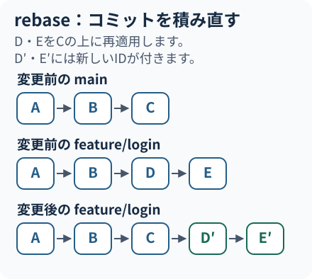
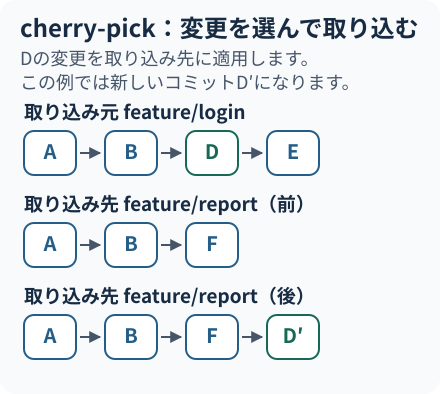
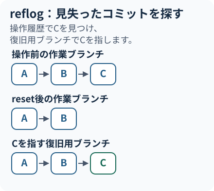

# 07 Git・GitHub応用編

> 対象：01〜06章を学習し、ブランチ作成・Pull Request・マージを経験した人  
> 目標：履歴の整理、変更の移植、復旧、原因調査、複数作業の並行管理を安全に行えるようになる。

[← 06 GitHubの便利な機能](06-features.md) ｜ [目次に戻る](../README.md#目次) ｜ [08 Git・GitHubのセキュリティ →](08-security.md)

---

## 7-1. 応用操作の前に：安全な練習環境

この章ではコミット履歴を変更する操作も扱います。**普段使っているチームのリポジトリではなく、練習用リポジトリ**で試してください。

```bash
git status
git branch --show-current
git log --oneline --graph --decorate -8
```

- `git status` で未コミットの変更を確認する。
- `git branch --show-current` は現在のブランチ名だけを表示する。ブランチから外れた状態では名前が表示されないため、`git status` で状況を確認する。
- `git log` の例は分岐とブランチ名を表示し、直近8件に絞る。[05章の履歴確認](05-tips.md#5-4-コミット履歴を見やすくするgit-log)の応用。
- 共有ブランチ（`main` など）の履歴を勝手に書き換えない。
- `git push --force` は原則使わない。特にチームの `main` には行わない。

## 7-2. `git rebase`：ブランチの起点を移動する

### 何のために使う？

自分の作業ブランチに、更新された `main` の変更を取り込み、履歴を直線的に整理できます。



`D'` と `E'` は元のコミットと内容が似ていても、**別のコミットID**になります。

### 操作例

```bash
git fetch origin
git switch feature/login
git rebase origin/main
```

作業ブランチのコミットだけが最新の `origin/main` の上に積み直されます。競合が発生したら、`git status` で対象を確認し、競合箇所を修正します。

```bash
git add <修正したファイル>
git rebase --continue
```

中止する場合：

```bash
git rebase --abort
```

**注意：** すでに他の人が使っているブランチをrebaseすると、履歴の不一致が起きることがあります。共有ブランチでは、通常の `merge` を選ぶ方が安全です。自分専用のリモートブランチをrebase後に更新する必要がある場合でも、影響を確認し、必要なときだけ `--force-with-lease` を検討します。

### mergeとの違い

| 操作 | 特徴 | 向いている場面 |
|---|---|---|
| `merge` | 既存の履歴を保って統合する | 共有ブランチでの安全な統合 |
| `rebase` | コミットを付け替え、履歴を書き換える | 自分の作業ブランチの整理 |

## 7-3. `git cherry-pick`：特定のコミットだけ取り込む

例えば、`feature/login` にある修正のうち1件だけを、`feature/report` に反映したい場合に使います。未コミットの変更を片付け、取り込み元の履歴でコミットIDを確認します。

```bash
git log --oneline feature/login
git switch feature/report
git cherry-pick abc1234
```

`abc1234` は取り込みたいコミットIDの例です。取り込まれた変更には新しいコミットIDが付くのが一般的です。



競合したら修正して：

```bash
git add <修正したファイル>
git cherry-pick --continue
```

取り込みを中止する場合：

```bash
git cherry-pick --abort
```

**注意：** 同じ修正を後から通常のマージでも取り込むと、重複や競合の原因になることがあります。必要なコミットだけに絞りましょう。

## 7-4. `git reflog`：操作履歴から復旧の手がかりを探す

`git log` に見えなくなったコミットでも、ローカルの `reflog` に記録が残っていることがあります。



```bash
git reflog
```

表示例：

```text
9f8e7d6 HEAD@{0}: reset: moving to HEAD~1
abc1234 HEAD@{1}: commit: Add login page
```

消えたと思ったコミットを見つけたら、まず**新しいブランチを作って保護**します。

```bash
git switch -c recovery-login abc1234
```

`reflog` は主にローカルの履歴で、永久に保存されるものではありません。他のPCの操作履歴まで復元できるわけではありません。

## 7-5. `git bisect`：バグが入り込んだコミットを特定する

「以前は正常だったのに、いつから壊れたか分からない」という場合に使います。

```bash
git bisect start
git bisect bad
git bisect good <正常だったコミットID>
```

Gitが候補のコミットに移動するので、動作を確認します。

```bash
git bisect good   # 正常なら
git bisect bad    # 不具合があれば
```

これを繰り返すと原因候補が絞り込まれます。テストできない候補は `git bisect skip` で飛ばせますが、原因を1件に絞れない場合があります。結果を控えてから次を実行し、調査前のブランチやコミットに戻ります。

```bash
git bisect reset
```

**前提：** 正常だったコミットが分かっていて、各コミットで正常・異常を判定できること。途中で依存関係が変わるプロジェクトでは検証方法にも注意が必要です。

## 7-6. `git worktree`：複数ブランチを別フォルダで開く

通常はブランチを切り替えて作業しますが、`worktree` を使うと別のフォルダで別ブランチを同時に扱えます。

```bash
# 現在のリポジトリ内から実行
git worktree add -b feature/docs ../project-docs main
```

`-b` で `main` から新しいブランチ `feature/docs` を作り、`../project-docs` で開きます。`-b` を省いて同じ引数を渡すと、既存の `main` を開こうとします。別の作業フォルダですでに開いているブランチは通常そのままでは開けません。そのフォルダをVSCodeで開き、そこで編集やコミットを行います。片方で機能開発を続けながら、もう片方でドキュメントを修正できます。

```bash
git worktree list
```

作業フォルダ内の変更をコミットするなどして安全な状態にした後、不要になったら：

```bash
git worktree remove ../project-docs
```

**注意：** 未コミットの変更があると削除できないことがあります。フォルダをOS上で直接削除するより、Gitのコマンドで管理する方が安全です。

## 7-7. GitHub FlowとGit Flow：ブランチ運用の考え方

### GitHub Flow（初心者のチームにおすすめ）

1. `main` を安定した状態に保つ。
2. Issueや作業内容ごとにブランチを作る。
3. 変更をpushしてPull Requestを作成する。
4. レビュー・テスト後に `main` にマージする。
5. 不要な作業ブランチを削除する。

```text
main ─────●────────────●────────●────
           \            ↑        ↑
feature/a   ●──●────────┘        │
feature/b        ●──●─────────────┘
```

### Git Flow

`main` に加えて `develop`、`feature/*`、`release/*`、`hotfix/*` などを使う運用です。複数のリリース工程を明確に管理したい場合に向きますが、初心者の小規模チームには複雑になりがちです。

**この教材では、まずGitHub Flowを推奨します。**

## 7-8. チームで使う開発ルール

### ブランチ名の例

```text
feature/add-score
fix/login-error
docs/update-readme
```

### コミットメッセージの例

```text
feat: スコア表示を追加
fix: ログイン時の例外を修正
docs: READMEの手順を更新
```

### Pull Requestで共有したい内容

- **目的：** なぜ変更するのか
- **変更点：** 何を変更したのか
- **確認方法：** どのテストを実行したか
- **注意点：** レビューで重点的に見てほしい点

テンプレートは `.github/pull_request_template.md` に置けます。

```markdown
## 目的

## 変更内容

## 動作確認
- [ ] ローカルで実行した
- [ ] 必要なテストを実行した

## 補足
```

## 7-9. GitHub Actions応用：Pythonのテストを自動実行する

06章で紹介したActionsを、Pull Requestの品質確認に活用します。この例では、リポジトリのルートに `tests/` があり、`unittest` のテストを検出できることが前提です。06章の `pytest` 用サンプルとは別に、練習用リポジトリで `tests/test_sample.py` を用意します。

```python
import unittest


class SampleTests(unittest.TestCase):
    def test_sum(self):
        self.assertEqual(sum([2, 3]), 5)
```

リポジトリのルートで `python -m unittest discover -s tests` を実行し、`Ran 1 test` と `OK` を確認します。macOSなどでは `python3`、Windowsでは `py -3` も使えます。

次に `.github/workflows/python-unittest.yml` を作成し、テストファイルと一緒にコミットします。

```yaml
name: Python tests

on:
  pull_request:
  push:
    branches: [main]

permissions:
  contents: read

jobs:
  test:
    runs-on: ubuntu-latest
    steps:
      - uses: actions/checkout@v4
      - uses: actions/setup-python@v5
        with:
          python-version: '3.12'
      - name: Run tests
        run: python -m unittest discover -s tests
```

Actionsでは **Run tests** のログを開き、テストが1件実行されて成功したことを確認します。既存のプロジェクトで使う場合は、実行された件数が想定どおりかを確かめます。実際の開発では、外部Actionのバージョン更新や権限の最小化も確認しましょう。[Pythonのテスト検出](https://docs.python.org/3.12/library/unittest.html#test-discovery)

## 7-10. 状況別コマンド早見表

| したいこと | コマンド | 注意点 |
|---|---|---|
| 最新のmainを作業ブランチに取り込む | `git rebase origin/main` | 自分のブランチで実行 |
| 特定の修正だけ取り込む | `git cherry-pick <ID>` | 重複取り込みに注意 |
| 消えたコミットを探す | `git reflog` | ローカル履歴・期限あり |
| バグ混入箇所を探す | `git bisect` | 正常・異常の判定が必要 |
| 複数作業を並行する | `git worktree add` | 別フォルダを管理 |
| mainへの直接pushを防ぐ | GitHub Rulesets | 06章参照 |

## 7-11. 理解度チェック

1. `merge` と `rebase` の違いは何ですか？
2. 他人が利用するブランチで、安易にrebaseしない方がよい理由は何ですか？
3. 別ブランチのバグ修正コミットだけを取り込むには、何を使いますか？
4. `git log` から見えなくなったコミットを探すとき、最初に確認するコマンドは何ですか？
5. 不具合が発生し始めたコミットを絞り込むコマンドは何ですか？
6. 小規模な初心者チームでGitHub Flowを採用する利点は何ですか？

---

## まとめ

応用コマンドは、使えること以上に**いつ使わないか**を判断することが重要です。共有ブランチの履歴を守り、作業前に状態を確認し、迷ったら安全なブランチを作って検証しましょう。

---

## 演習問題

- [演習07：Git・GitHub応用編](exercise/07-advanced-exercise.md)
- [演習07：回答例・解説](exercise/answer/07.md)

---

## 参考資料（公式）

- [git rebase](https://git-scm.com/docs/git-rebase)
- [git cherry-pick](https://git-scm.com/docs/git-cherry-pick)
- [git reflog](https://git-scm.com/docs/git-reflog)
- [git bisect](https://git-scm.com/docs/git-bisect)
- [git worktree](https://git-scm.com/docs/git-worktree)
- [GitHub Flow](https://docs.github.com/ja/get-started/using-github/github-flow)

---

[← 06 GitHubの便利な機能](06-features.md) ｜ [目次に戻る](../README.md#目次) ｜ [08 Git・GitHubのセキュリティ →](08-security.md)
