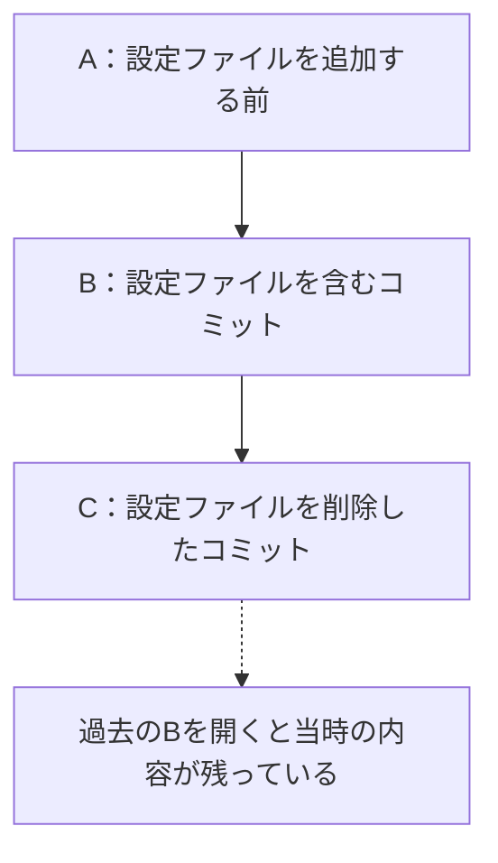
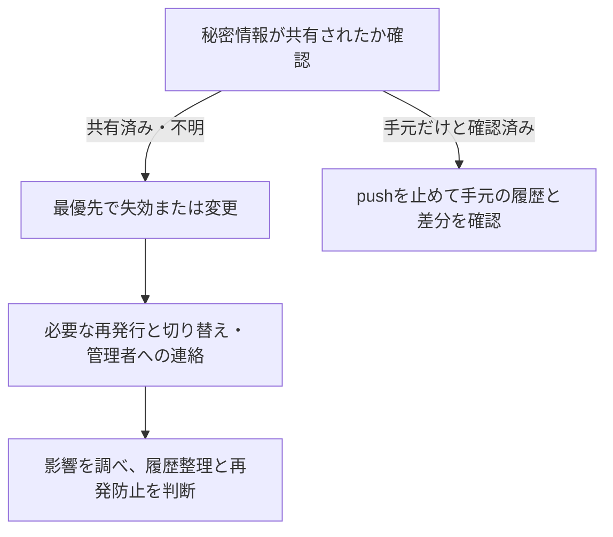
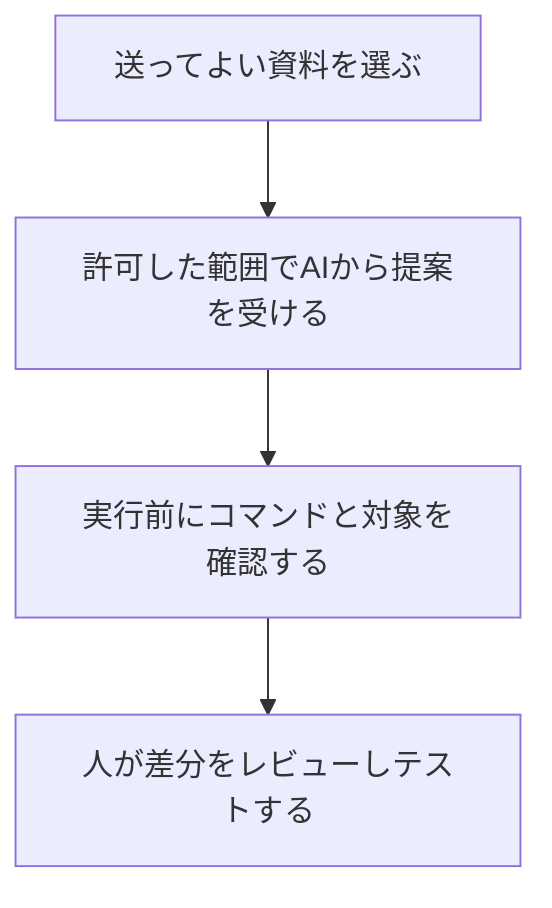

# 08 Git・GitHubのセキュリティ

> **対象**：Git・GitHubの基本操作を学び、個人開発やチーム開発で使う人
>
> **ゴール**：共有前にリスクを見つけ、事故が起きたら対応の順序を決め、チームやAIツールに渡す権限を判断できる。

[← 07 Git・GitHub応用編](07-advanced.md) ｜ [目次に戻る](../README.md#目次)

---

## 8-1. 開発で起こるセキュリティ事故

コードが正しく動いていても、設定や共有方法が原因で事故は起こります。どの情報や操作が、誰にまで届くかを考えておくと、事故を防ぎ、発生後も対応の優先順位を決めやすくなります。

| 開発中の出来事 | 起こり得る影響 |
|---|---|
| APIキーを設定ファイルと一緒にpushする | キーの権限でサービスが使われ、データへのアクセスや意図しない課金が起こる |
| 参加者一覧入りのデータベースを共有する | 氏名や連絡先が、本来閲覧する必要のない人に渡る |
| 外部ライブラリやActionsを内容を確認せず更新する | 脆弱性が入り込んだり、改ざんされたコードが開発PCやCIで動いたりする |
| 調査のために本番ログをAIツールへ貼り付ける | ログに含まれる認証情報、個人情報、非公開の設定がツールへ送信される |

## 8-2. 公開範囲とアクセス権限

| 公開範囲 | 誰が閲覧できるか | 共有するときに確認すること |
|---|---|---|
| Public | 誰でも閲覧できます。現在のファイルに加えて、公開ブランチのコミット履歴も読めます。 | 公開できる素材だけで構成されているか、履歴にも秘密情報がないかを確認する。 |
| Private | 権限を持つアカウントや、許可された連携・自動処理がアクセスできます。 | 閲覧者、共同作業者、自動処理に与えた権限を確認する。秘密情報は専用の保管先で管理する。 |

公開範囲と書き込み権限は別です。Publicにしても、閲覧者に元のリポジトリへの書き込み権限は付きません。組織のリポジトリでは、閲覧だけのメンターには `Read`、変更を共同で進めるメンバーには必要に応じて `Write` を割り当てます。設定管理を担当する人に管理権限を絞る考え方が**最小権限**です。チーム経由で持っている権限も確認し、作業が終わったら不要になったアクセスを見直します。[GitHubのリポジトリ公開範囲](https://docs.github.com/en/repositories/creating-and-managing-repositories/about-repositories#about-repository-visibility)・[組織リポジトリのロール](https://docs.github.com/en/organizations/managing-user-access-to-your-organizations-repositories/managing-repository-roles/repository-roles-for-an-organization)

## 8-3. アカウントと認証情報を守る

| 仕組み | 何を守るか | 使うときの確認 |
|---|---|---|
| 二要素認証（2FA） | GitHubへのサインインを追加の認証で保護します。 | リカバリーコードを安全な場所に保管します。認証アプリなどの設定は[00章](00-install.md#2-4-二要素認証2faを設定する)を参照してください。 |
| PAT（個人アクセストークン） | スクリプトなどがGitHubにアクセスするときに使う認証情報です。 | 用途を満たす場合はFine-grained PATを選び、対象リポジトリ・権限・有効期限を絞ります。認証情報マネージャーなどで管理し、不要になったら失効させます。 |
| SSH鍵 | PCからの接続に鍵を使って本人確認します。 | 公開鍵をGitHubに登録し、秘密鍵はPCで保護します。秘密鍵は共有せず、パスフレーズを付けて管理します。設定は[00章](00-install.md#9-1-ssh鍵による認証)を参照してください。 |

二要素認証でサインインを保護していても、漏えいしたPATなどは有効な間に使われる可能性があります。アカウントの保護と、個々の認証情報の保管を両方行います。[PATの管理](https://docs.github.com/en/authentication/keeping-your-account-and-data-secure/managing-your-personal-access-tokens)・[SSH鍵とパスフレーズ](https://docs.github.com/en/authentication/connecting-to-github-with-ssh/working-with-ssh-key-passphrases)

## 8-4. Gitで管理するファイルを選ぶ

APIキーやパスワードをソースコードに書く代わりに、実行環境から**環境変数**として渡すと、同じコードを異なる環境で動かせます。`.env` は、対応するツールやアプリが設定を読み込むために使うファイルです。環境変数や `.env` に値を移しても、表示や保存のしかたによっては値が漏れるため、ログやスクリーンショットにも出さないようにします。

| ファイルの例 | Gitでの扱い |
|---|---|
| `.env` | 手元用の設定。実際のキーやパスワードが入るなら共有対象から外す。 |
| `.env.example` | 必要な項目名だけ、または無害なダミー値を入れて共有する。例として `DEMO_API_KEY=REPLACE_ME`。 |
| `.gitignore` | 無視するファイルのルールをチームで共有する。すでに追跡中のファイルや過去のコミットは、ルールを追加しても自動では消えない。[05章のファイル除外](05-tips.md#5-6-不要なファイルを除外するgitignore) |
| 実データ入りのSQLiteファイル、データベースのエクスポート、本番ログ | 承認された保管先や共有方法を使う。個人情報や秘密情報を含む元データはGitに入れない。 |
| スキーマ、マイグレーション、ダミーデータ | 個人情報・認証情報を含まないことを確かめて共有する。再現に必要なテーブル構成や入力例を伝えられる。 |

たとえば、プロジェクトの `.gitignore` に次の1行を追加し、`.env.example` はダミー値のまま共有します。

```gitignore
.env
```

コミット前は変更ファイルの一覧とステージ済みの差分を確認します。PRの本文、添付画像、CIのログなど、Gitの追跡対象以外の共有先にも注意します。

## 8-5. 秘密情報をコミット・pushしてしまったら

共有済み、または共有されていないと確認できない認証情報は、**発行元での失効を最優先**にします。パスワードなら速やかに変更します。担当者が別にいる場合は、すぐに連絡して失効を依頼します。必要に応じて新しい値を発行し、利用中のアプリやCIを切り替えます。

### ファイルを削除しても履歴に残る理由

Gitのコミットは、その時点のファイルの状態を記録しています。後のコミットでファイルを消しても、前のコミットを参照すれば当時の内容を読めます。



### 判断と対応の順序



- **手元だけの場合**は、pushする前に該当するコミットを特定し、送る履歴に値が含まれないよう修正します。手元の変更を失わないよう確認してから操作します。共有された可能性があれば失効を優先します。[04章の未共有の変更への対処](04-troubleshooting.md#4-5-まだpushしていない変更を間違えた)
- **管理者への連絡**では、値を貼らずに、発見時刻、対象リポジトリ・ファイル・コミット、権限、失効状況を伝えます。
- **影響範囲**は、キーが使えた期間と権限、発行元の利用履歴や操作ログ、PR・Actionsログ・フォークなど、値を含む共有先を調べます。個人情報が含まれる場合は所属先の担当窓口に連絡します。
- **履歴の整理**は管理者と判断します。履歴を書き換える場合はコミットIDや共同作業に影響します。必要に応じてフォークやクローンなどのコピーも扱います。ファイル削除やPrivateへの変更だけで、取得済みのコピーは回収できません。
- **再発防止**では、除外ルール、差分確認、秘密情報を渡す仕組みを見直します。対応が終わったら発行元で旧キーが無効になったことと、新しい設定でサービスが正常に動くことを確かめます。[GitHub公式の機密データ削除手順](https://docs.github.com/en/authentication/keeping-your-account-and-data-secure/removing-sensitive-data-from-a-repository)

## 8-6. 外部ライブラリとGitHubの検出機能

ライブラリの既知の脆弱性は、アプリが依存するバージョンを通じて影響します。**サプライチェーン攻撃**は、ライブラリの配布元や開発者のアカウント、ビルドに使うActionsなどが侵害され、改ざんされたコードが開発環境へ入る例があります。更新PRではパッケージの名前・入手元・バージョン・依存関係の差分を確認し、テストしてから取り込みます。

| 機能 | 主に見つけるもの | 利用条件の目安 |
|---|---|---|
| Dependabot | 依存ライブラリの既知の脆弱性を知らせます。Security updatesは修正可能な依存関係の更新PRを作成し、Version updatesは通常の更新を扱います。 | 公開・非公開リポジトリで利用できます。対応するパッケージ形式と、依存関係グラフや各機能の設定を確認します。[Dependabot alerts](https://docs.github.com/en/code-security/dependabot/dependabot-alerts/about-dependabot-alerts) |
| Secret scanning | コミット履歴などに含まれる、対応パターンの認証情報を検出します。Push protectionは対応する秘密情報を含むpushを送信時に止める機能です。 | GitHub.comの公開リポジトリでは無料でSecret scanningが自動実行されます。組織のPrivate・Internalでは、GitHub TeamまたはEnterprise CloudでGitHub Secret Protectionの有効化が必要です。検出対象やPush protectionの設定は別途確認します。[Secret scanning](https://docs.github.com/en/code-security/concepts/secret-security/secret-scanning) |
| Code scanning | CodeQLなどでコードを分析し、脆弱性や問題の候補を知らせます。 | GitHub.comの公開リポジトリで利用できます。GitHub.comの組織の非公開リポジトリでは、GitHub TeamまたはEnterprise CloudでGitHub Code Securityの有効化が必要です。Actionsで分析する場合は実行時間も確認します。[Code scanning](https://docs.github.com/en/code-security/code-scanning/introduction-to-code-scanning/about-code-scanning) |

GitHub.comの利用条件の確認日：2026年11月26日。組織の設定やプランで使える範囲が変わります。検出機能は対象外のパターンや新しい問題を見逃すことがあるため、差分・テスト・レビューも続けます。

## 8-7. GitHub Actionsの権限とSecrets

- **`GITHUB_TOKEN` に必要な権限を割り当てます。** チェックアウトしてテストするだけのジョブなら、原則として `contents: read` から始めます。リリースなど書き込みが必要な処理は別のジョブに分け、そのジョブだけに必要な権限を追加します。外部のActionは提供元を確認し、運用では完全なコミットSHAで固定する方法もあります。[トークンの権限](https://docs.github.com/en/actions/security-for-github-actions/security-guides/automatic-token-authentication)・[Actionsの安全な運用](https://docs.github.com/en/actions/reference/security/secure-use)
- **必要な秘密情報はActions Secretsで管理します。** リポジトリ、環境、組織から用途に合う範囲を選び、必要なジョブだけに値を渡します。ログへの出力は避けます。GitHub Freeでは、組織レベルのSecretsをPrivateリポジトリから参照できません。[Actions Secrets](https://docs.github.com/en/actions/how-tos/write-workflows/choose-what-workflows-do/use-secrets)
- **外部からのPRでは、テストと秘密情報が必要な処理を分けます。** 未レビューの変更を実行するジョブに本番の資格情報を渡さず、デプロイは確認済みの変更を扱うジョブや承認された環境で行います。基本のワークフローは[06章のGitHub Actions](06-features.md#6-5-github-actionsテストを自動化する)を参照してください。

## 8-8. AI開発支援ツールを安全に使う

Claude CodeやCodexなどの開発支援ツールは、設定によって作業フォルダを読み、ファイルを書き換え、コマンドを実行できます。ツールを使う前に、どのデータを読み、どこに送信し、どこまで変更できるかを確認します。

| 場面 | リスクと確認すること |
|---|---|
| 調査のためにログやコードを渡す | 非公開コードや本番ログは、チームの許可と利用条件を確認します。秘密情報・個人情報は渡さず、必要な範囲をダミーデータや伏せ字に置き換えます。 |
| エージェントに作業を任せる | 作業フォルダとファイル・ネットワーク・書き込み権限を目的に合わせて絞ります。本番キーやデプロイ権限を持つ環境から分け、コマンド実行前に対象と副作用を確かめます。 |
| Issueや外部資料を読ませる | 資料に紛れた指示がツールの動作を変えようとすることを**プロンプトインジェクション**と呼びます。文書は参照データとして扱い、外部送信や更新などの判断にはチームのルールと人の確認を使います。 |
| AIの提案を取り込む | 生成コードにも、権限チェック漏れや不要な依存関係が入り得ます。差分を人がレビューし、正常な入力に加えて不正な入力や権限のない場合もテストします。 |



LLMアプリで外部資料を扱う設計は[LLMアプリの設計入門](llm/README.md)を参照してください。[OWASPのプロンプトインジェクション対策](https://cheatsheetseries.owasp.org/cheatsheets/LLM_Prompt_Injection_Prevention_Cheat_Sheet.html)

## 8-9. 開発中に使うチェックリスト

| 場面 | 確認すること |
|---|---|
| 開発開始前 | 公開範囲、メンバーの権限、2FA、認証情報の保管先、実データを扱う場所を確認した。 |
| コミット・push前 | 変更ファイルと差分に秘密情報・個人情報がなく、設定例にはダミー値だけが入っている。 |
| PR・マージ前 | 差分とテスト結果を確認した。権限・依存関係・ワークフローの変更には意図と確認結果がある。 |
| AIツール利用前 | 渡してよいデータと許可する操作を決めた。外部送信や書き込みを伴う操作を事前に確認する。 |
| 漏えい発覚時 | 有効な認証情報を失効または変更し、値を再共有せず管理者に連絡した。影響の確認と再発防止を担当者と進める。 |

---

## 演習問題

- [演習08：セキュリティのケーススタディ](exercise/08-security-exercise.md)
- [演習08：判断の根拠と解説](exercise/answer/08.md)

---

## 参考資料（公式）

- [GitHub Docs：二要素認証について](https://docs.github.com/en/authentication/securing-your-account-with-two-factor-authentication-2fa/about-two-factor-authentication)
- [GitHub Docs：リポジトリから機密データを削除する](https://docs.github.com/en/authentication/keeping-your-account-and-data-secure/removing-sensitive-data-from-a-repository)
- [GitHub Docs：GitHub Actionsの安全な運用](https://docs.github.com/en/actions/reference/security/secure-use)
- [OWASP：LLM Prompt Injection Prevention Cheat Sheet](https://cheatsheetseries.owasp.org/cheatsheets/LLM_Prompt_Injection_Prevention_Cheat_Sheet.html)

---

[← 07 Git・GitHub応用編](07-advanced.md) ｜ [目次に戻る](../README.md#目次)
