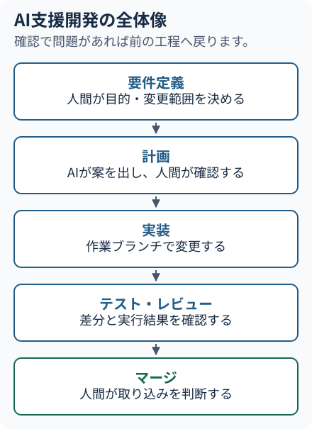
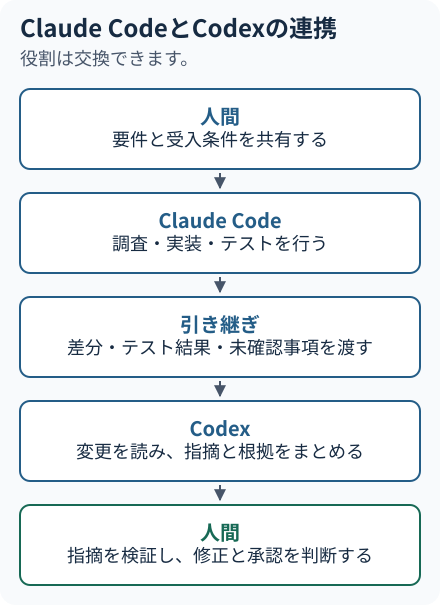
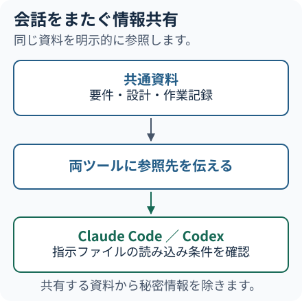
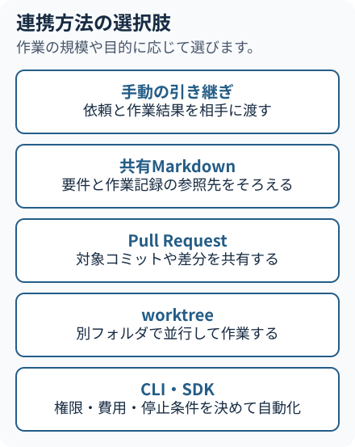
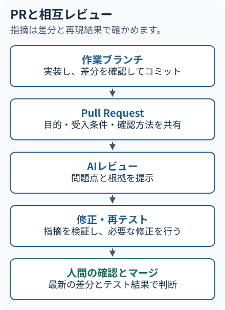
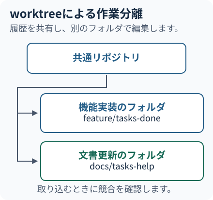
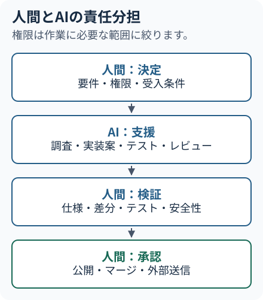

# Claude Code・Codexを活用したAI支援開発｜補足教材

[← 教材トップ](../../README.md#補足教材)

AIに調査や実装を依頼し、変更を別の担当に引き継ぎ、人間が差分とテスト結果を確かめてから取り込みます。題材はPythonのタスク一覧アプリです。本文は約45分、演習は約30分です。演習はAIツールなしでも取り組めます。

- [01 AI開発支援ツールとは](#01-ai開発支援ツールとは)
- [02 基本的な使い方](#02-基本的な使い方)
- [03 AIへの指示の出し方](#03-aiへの指示の出し方)
- [04 Claude CodeとCodexの連携](#04-claude-codeとcodexの連携)
- [05 Git・GitHubとの連携](#05-gitgithubとの連携)
- [06 安全なAI支援開発](#06-安全なai支援開発)
- [07 実践例](#07-実践例)
- [演習問題](exercise.md) ｜ [回答例と評価の観点](answer.md)

## 01 AI開発支援ツールとは

Claude CodeとCodexは、利用環境と許可に応じて、リポジトリの調査、ファイルの編集、コマンドの実行を支援します。コードの一部をチャット欄に貼って相談する使い方では、人が必要な情報を選び、提案を手元で試します。作業環境につながるツールでは、AIが複数のファイルを調べ、変更と実行結果をまとめられます。



| 利用環境 | 適した場面 | 最初に確認すること |
|---|---|---|
| CLI（ターミナル） | Gitやテストを実行するフォルダで調査・編集する | 現在のディレクトリとブランチ |
| IDE拡張（VSCodeなど） | 開いているコードと変更差分を見ながら相談する | 対象のワークスペースと渡すファイル |
| クラウド | 接続したリポジトリを使い、別環境で作業する | リポジトリへのアクセス、セットアップ、利用条件 |

両ツールともこれらの利用形態があります。CLIやIDEでも、手元でコマンドを実行することと、モデルへの入力が端末内で処理されることは別です。コードを渡す前に、利用形態ごとのデータの扱いを確認します。[Claude Codeの利用環境](https://code.claude.com/docs/en/overview)・[Codexの利用環境](https://learn.chatgpt.com/docs/quickstart)

AIはコードの読み解き、変更案、テストのたたき台づくりに向いています。文書化されていない仕様や、確認できない環境の動作を推測で埋めることもあるので、判断に必要な根拠を人が確かめます。アプリ自体にLLMを組み込む場合は[LLMアプリの設計入門](../llm/README.md)を参照してください。

### 学習時と開発時で任せる範囲を変える

**学習時**は、次に何を確かめるかを自分で考えられるようになることが目標です。たとえば `--done` の演習なら、まず引数がある場合とない場合の出力を予想します。行き詰まったら「どの条件を見ればよいか、ヒントを1つだけください」と頼み、ヒントを手がかりに自分で試します。解いた後は、別の入力でも同じ考え方が通用するかを確かめます。

**実際の開発時**は、調査や実装の一部をAIに任せて作業を進められます。任せる前に要件と受入条件を決め、生成コードの入力・条件分岐・出力を追って、設計の意図と既存動作への影響を確認します。たとえば「テストが通った」というAIのレビューを読んだら、実行したケースと期待結果を確かめ、未指定時や該当データがない場合も必要に応じて検証します。説明に自信がない箇所は、差分や公式資料を調べ、採用する理由を説明できる状態にしてから判断します。[教材全体の共通方針](../../README.md#学習と開発でのaiの使い方)

## 02 基本的な使い方

使う場合は、OSと利用形態に合った導入・認証方法を公式手順で確認します。契約、利用枠、追加料金、組織の設定は確認日以降も変わり得ます。確認日 2026年11月27日。[Claude Codeのクイックスタート](https://code.claude.com/docs/en/quickstart)・[Codexのクイックスタート](https://learn.chatgpt.com/docs/quickstart)

利用形態によって、契約に含まれる枠とAPIの従量課金が異なります。利用前に自分のアカウントで確認します。[Claude Codeの利用枠と費用](https://code.claude.com/docs/en/costs)・[Codexの料金と利用枠](https://learn.chatgpt.com/docs/pricing)

1. **調査する**。練習用リポジトリを開き、「ファイルを編集せず、入口となるファイル、入出力、テストの実行方法をファイル名付きで教えて」と依頼します。
2. **原因を絞る**。エラーを相談するときは、再現に使った入力、期待した結果、実際の結果を伝えます。ログに認証情報があれば取り除きます。複数の原因候補があるときは、それぞれどこで確かめるかを聞きます。
3. **変更とテストを依頼する**。変更対象と受入条件を伝え、修正に対応するテスト案を出してもらいます。実行前にコマンドと作業場所を確認します。
4. **証拠を読む**。変更ファイルは `git status --short`、編集内容は `git diff` や `git diff --staged` で確認します。新規ファイルの中身も開きます。テストの実行コマンド、成功・失敗、実行できなかった項目を確認します。[05章の差分確認](../05-tips.md)

## 03 AIへの指示の出し方

| 指示の要素 | 曖昧な例 | 具体的な例 |
|---|---|---|
| 目的と背景 | タスク一覧を使いやすくして | 一覧から完了済みタスクだけを確認したい |
| 変更範囲・制約 | 必要なところを直して | `tasks.py` と対応するテストだけを変更し、外部ライブラリとデータ形式は変更しない |
| 受入条件 | 動けば完成 | `--done` 指定時は完了済みだけ、未指定時は従来どおり全件。表示対象が0件なら正常終了 |
| 作業段階 | まずやってみて | まず現状を調査し、変更する箇所とテスト案を提示。実装は計画を確認してから |

調査段階では読み取り中心の権限に絞ります。Claude CodeのPlan ModeやCodexの権限設定など、現在の環境で使える制御を確認し、「まだ編集しない」という依頼と合わせて使います。[Claude Codeの権限](https://code.claude.com/docs/en/permissions)・[Codex CLI](https://learn.chatgpt.com/docs/cli)

`AGENTS.md` や `CLAUDE.md` には、標準テストの実行方法や編集時の約束など、複数の作業に共通するルールを記述できます。今回の要件や作業状況は別の共有資料に置くと更新箇所を追えます。Codexは `AGENTS.md` を使います。Claude Codeは `CLAUDE.md` を使え、`AGENTS.md` の読み込みもバージョン、設定、他の指示ファイルの有無に応じて利用できます。作業場所と読み込まれたファイルを確認し、書き込みや送信の制限は権限設定で管理します。[CodexのAGENTS.md](https://learn.chatgpt.com/docs/agent-configuration/agents-md)・[Claude Codeの指示ファイル](https://code.claude.com/docs/en/memory#agentsmd)

## 04 Claude CodeとCodexの連携

調査と実装をClaude Code、差分レビューをCodexに任せる例です。役割は交換できます。別の視点で既存動作や抜けたテストを確認できる一方、同じ誤りを見逃す可能性があり、引き継ぎの手間や利用枠・費用も増えます。変更の大きさや判断の難しさに応じて担当を分けます。



別のツールやセッションに会話が自動で共有されるとは限りません。小さな変更なら、同じ要件へのリンクと次のメモをコピーして渡せます。設計や作業記録を複数人で更新する場合は、要件・設計・記録を共有MarkdownやPRに置き、参照先をそろえます。



```markdown
- 目的と受入条件: --done 指定時は完了済みだけ表示。未指定時は全件表示
- 確認対象: feature/tasks-done のコミット <コミットID>、比較先は main
- 変更と理由: tasks.py に表示フィルターを追加
- 確認済み: 通常データで指定時と未指定時の出力を比較
- 未確認: 完了済みが0件の場合
- 依頼: 対象の差分をレビュー。懸念には該当箇所・期待結果・再現条件を添える
```



CLIの非対話実行やSDKを使えば、決めた差分からレビュー結果を取得する作業などを自動化できます。その場合も、参照する差分、出力形式、権限、実行回数・費用の上限、停止条件を明示し、結果は人間が確認します。[Claude Agent SDK](https://code.claude.com/docs/en/agent-sdk/overview)・[Codex SDK](https://learn.chatgpt.com/docs/codex-sdk)

## 05 Git・GitHubとの連携

作業ブランチで変更を作り、差分を確認してコミットします。PRには目的・受入条件・変更内容・テスト結果・未確認事項を記載します。AIにレビューを依頼する場合は比較先と対象コミットを指定し、問題点の根拠を求めます。修正後は最新の差分とテスト結果を人間が確認してマージします。[03章のPRとレビュー](../03-team.md)



複数のAIが同時に編集するなら、`git worktree` で別ブランチを別フォルダに開き、担当ファイルと統合順を決めます。たとえば `feature/tasks-done` と文書を担当する `docs/tasks-help` を分けます。レビューだけなら、対象コミットと差分を渡す方法もあります。worktree間ではGitの履歴などが共有され、権限はツール側で別に設定します。同じ箇所を変更した場合の競合は統合時に確認します。[07章のworktree操作](../07-advanced.md)・[Git公式マニュアル](https://git-scm.com/docs/git-worktree)



## 06 安全なAI支援開発



| 場面 | 人間が確認すること |
|---|---|
| 作業前 | 調査なら必要なフォルダの読み取りに絞る。編集とコマンド実行は作業に必要な範囲だけ許可する。 |
| 入力・引き継ぎ前 | APIキー、認証情報、個人情報を除く。送信先と組織のデータ利用ルールを確認する。 |
| コマンド実行前 | Issue・ログ・外部文書に紛れた指示は資料の一部として扱う。削除や外部送信を求める文に従う前に、依頼者の指示と許可範囲を確認する。 |
| コミット・マージ前 | 意図しないファイル変更、依存関係、テストの欠落を確認する。AIの説明は差分と再現結果に照らし、人間が公開範囲とマージを判断する。 |

秘密情報が漏えいした場合の初動や、プロンプトインジェクションの詳しい説明は[08章](../08-security.md)を参照してください。

## 07 実践例

練習用リポジトリに、次の内容を `tasks.py` として保存した状態から始めます。会話例は教材用の例で、Pythonの動作は手元でも試せます。

```python
import argparse

tasks = [("資料を読む", True), ("演習を解く", False)]

parser = argparse.ArgumentParser()
args = parser.parse_args()

for name, done in tasks:
    print(name)
```

1. **人間が要件を決める。** `--done` 指定時は完了済みだけ、未指定時は全件を同じ順で表示する。完了済みが0件なら表示なしで正常終了する。
2. **Claude Codeに調査を依頼する。** 「現状の引数処理と表示箇所を調べ、編集せず、変更箇所とテスト案を提示して」と伝える。
3. **人間が計画を確認する。** データ形式を保ち、変更が小さく、指定時と未指定時の両方を確認できる計画かを読む。
4. **Claude Codeが作業ブランチで実装する。** たとえば `feature/tasks-done` を使い、引数の追加と必要な行だけの絞り込みを依頼する。
5. **Codexが差分をレビューする。** 変更の目的と受入条件、比較対象を渡し、「既存動作への影響と不足テストを、該当箇所付きで示して」と依頼する。
6. **人間が指摘を検証し、必要なら修正する。** たとえば「未指定時にも完了済みだけを表示する」という指摘なら、実際の出力と絞り込み条件を確認する。
7. **テストを実行する。** 次の2通りの出力を照合する。完了済み0件の確認は練習用コピーで全件を未完了にし、出力なし・正常終了を確認する。確認用データの変更はPRから除く。
8. **人間がPRを確認してマージする。** 変更とテスト結果をPRに記載し、取り込む最新差分を確認する。Codexを実装担当、Claude Codeをレビュー担当にしても同じ進め方で確認できる。

| 実行例 | 期待する出力 |
|---|---|
| `python tasks.py` | 「資料を読む」「演習を解く」が1行ずつ |
| `python tasks.py --done` | 「資料を読む」の1行 |

<details>
<summary>実装例の差分</summary>

```diff
 parser = argparse.ArgumentParser()
+parser.add_argument("--done", action="store_true")
 args = parser.parse_args()

 for name, done in tasks:
-    print(name)
+    if not args.done or done:
+        print(name)
```

</details>

---

[← 教材トップ](../../README.md#補足教材) ｜ [演習問題](exercise.md) ｜ [回答例と評価の観点](answer.md)
