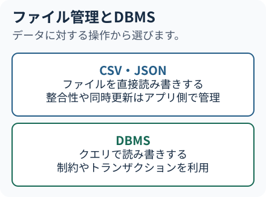
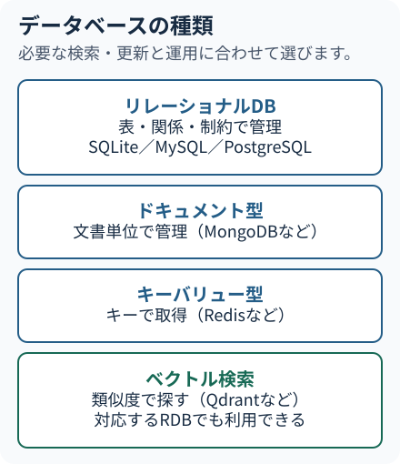

# 01 データベースの基礎

[← 補足教材の目次](README.md) ｜ [02 データベース設計 →](02-design.md)

## 必修｜DBとDBMS、ファイル管理の違い

**データベース（DB）**は整理して保存したデータの集まりです。**DBMS**は、データを保存・検索・更新するソフトウェアです。文房具店なら商品と注文明細がDBに入り、SQLiteなどのDBMSが検索や更新を処理します。

| 選択肢 | 向いている場面 |
|---|---|
| CSV | 表計算ソフトに商品一覧を渡す、集計結果を出力する |
| JSON | アプリ設定や、APIでやり取りする階層のあるデータを保存する |
| DBMS | 商品と明細を関連付ける、入力ルールをそろえる、複数の更新をまとめて確定する |

DBは読み書きや制約を共通化できます。同時更新の扱いはDBMSによって異なるので、同時に誰が何を変更するかを考えて選びます。

## 必修｜リレーショナルDBとNoSQL

リレーショナルDBはテーブルをキーで結び、SQLで操作します。注文や在庫など、関係とルールを持つデータに適しています。**NoSQL**はリレーショナル以外を含む総称です。扱うデータや検索方法に応じて、異なる形式を使います。

| DBMS | 特徴と選ぶ例 |
|---|---|
| SQLite | アプリ内で動き、ファイルやメモリに保存できます。学習、試作、端末内の保存に向きます。 |
| MySQL | サーバーに接続して使います。既存のチームやホスティングで採用済みなら運用をそろえやすくなります。 |
| PostgreSQL | サーバーに接続して使います。複雑な検索や、JSONなどの型を利用するシステムにも使えます。 |

## 推奨｜必要な操作から選ぶ

文書ごとに異なる属性を持つ商品情報には**ドキュメントDB**、セッションIDから値をすぐに取得したい用途には**キーバリュー型DB**、説明文の意味が近い商品を探す用途には**ベクトル検索**が候補です。ベクトル検索は専用DBのほか、対応するリレーショナルDBでも利用できます。

文房具店の演習では、商品と明細の関係をSQLで確認でき、サーバーを立てずに試せるSQLiteを選びます。実際の導入では、検索・更新の種類、利用者数、復旧や運用を担当できるかを比較します。[SQLiteの適した用途](https://sqlite.org/whentouse.html)・[MySQL公式資料](https://dev.mysql.com/doc/)・[PostgreSQL公式資料](https://www.postgresql.org/docs/)

---

[← 補足教材の目次](README.md) ｜ [02 データベース設計 →](02-design.md)
