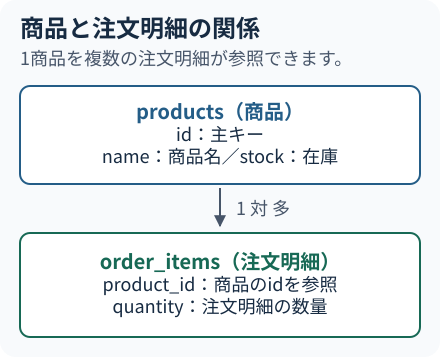
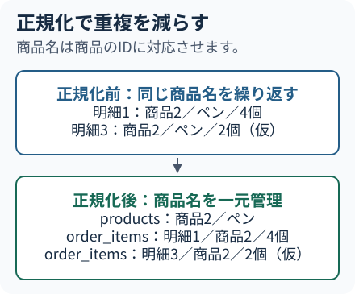

# 02 データベース設計

[← 01 データベースの基礎](01-basics.md) ｜ [目次に戻る](README.md) ｜ [03 SQLの基本 →](03-sql.md)

## テーブル・データ型・制約

`products` は商品をまとめた**テーブル**です。ペン1件分が**レコード（行）**、商品ID・商品名・在庫数などの項目が**カラム（列）**です。名前は文字列、在庫数は整数にすると、並べ替えや計算に使えます。入力ルールはアプリの画面でも確認し、DBでも**制約**を設定すると、別の経路から不正な値が入るのを防げます。

| 制約 | 商品・注文明細での例 |
|---|---|
| 主キー（`PRIMARY KEY`） | `products.id` で商品を一意に識別する |
| 外部キー（`FOREIGN KEY`） | `order_items.product_id` が存在する商品を参照する |
| `NOT NULL`・`UNIQUE` | 必須項目や重複させない項目を決める |
| `CHECK` | 在庫は0以上など、値の範囲を表す制約を設計できる |

既存サンプルでは整数型などと主キー・外部キーを使っています。SQLiteの型の扱いには独自の規則があり、外部キーの検証は接続ごとに有効にします。[SQLiteのデータ型](https://sqlite.org/datatype3.html)・[SQLiteの外部キー](https://sqlite.org/foreignkeys.html)

## ER図で関係を考える

ER図では「片方の1行に対して、もう片方の行は何件あり得るか」を両側から読みます。最初に保存する対象を箱で描き、識別子を決め、関係を線で結びます。実装に移るときは、どの表が外部キーを持つか、項目の必須性や重複可否も書きます。

| 関係 | 設計の例 |
|---|---|
| 1対1 | 商品と詳細情報。詳細テーブルの `product_id` を外部キーかつ主キーにし、商品1つにつき最大1件にする。 |
| 1対多 | 商品と注文明細。明細に `product_id` を置き、同じ商品を複数の明細から参照できるようにする。 |
| 多対多 | 商品とタグ。中間テーブル `product_tags` に双方のIDを置き、IDの組を主キーにする。 |

## 正規化で変更箇所を減らす

明細ごとに商品名も保存すると、商品名を変更したときに明細ごとに直す必要が生じます。商品名を `products` に集め、明細から商品IDで参照すれば、名前を管理する場所を1つにできます。図の明細3は説明のために加えた架空の行です。

第1〜第3正規形を同じ例で考える

注文の控えに、複数の商品と数量、さらに商品名とカテゴリ名まで書かれているとします。1注文につき同じ商品は1明細とし、明細のキーを「注文IDと商品IDの組」とします。

1. **第1正規形**では、1つの欄に商品を複数並べず、注文と商品の組ごとに1行にします。
2. **第2正規形**では、複合キーの一部だけで決まる項目を分けます。数量は注文IDと商品IDの組で決まり、商品名は商品IDだけで決まるので、商品表へ移します。
3. **第3正規形**では、キー以外の項目を経由して決まる情報を分けます。カテゴリIDからカテゴリ名が決まる設計なら、商品表にカテゴリIDを置き、カテゴリ名はカテゴリ表で管理します。

共通サンプルは学習用の簡略版です。カテゴリに独自の設定や名称変更の要件がある場合に、カテゴリ表を設ける設計を検討します。

## インデックスで検索を助ける

`product_id` で明細を頻繁に探すなら、その列へのインデックスが候補です。検索を速くできる一方、保存領域を使い、追加・更新時にもインデックスの維持が必要です。よく使う検索条件を確認してから追加します。[SQLiteのクエリプランナー](https://sqlite.org/queryplanner.html)

---

[← 01 データベースの基礎](01-basics.md) ｜ [目次に戻る](README.md) ｜ [03 SQLの基本 →](03-sql.md)
