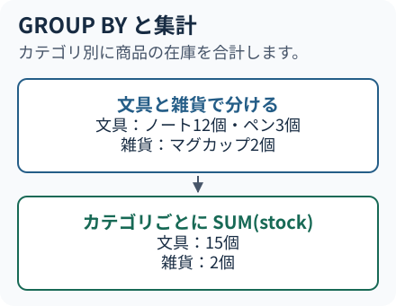
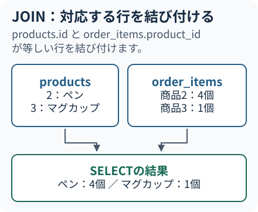

# 03 SQLの基本

[← 02 データベース設計](02-design.md) ｜ [目次に戻る](README.md) ｜ [04 アプリケーションとの連携 →](04-application.md)

## 必修｜SQLを用途で選ぶ

SQLは、DBMSにテーブルの定義やデータの検索・変更を伝える言語です。文の分類は資料によって異なります。この教材では、読む・変える・構造を定義する用途を区別します。

| 用途 | 代表的な文 | 使う場面 |
|---|---|---|
| 構造を定義する（DDL） | `CREATE`、`ALTER`、`DROP` | テーブルを作る、列を足す、テーブルを削除する |
| データを変更する（DML） | `INSERT`、`UPDATE`、`DELETE` | 商品を登録する、在庫を変える、不要な行を消す |
| データを取得する | `SELECT` | 在庫の少ない商品や注文の一覧を表示する |
| 変更を確定・取り消す | `COMMIT`、`ROLLBACK` | 複数の操作をまとめて確定・取り消す |

最初は[既存のSQLite実習](../sql/README.md#3-実際に動かしてみよう)で共通データを読み込みます。更新や削除の前に、同じ条件で対象行を確認します。構造変更や削除は練習用DBで試してください。

## 必修｜絞り込み・集計・結合

- **絞り込みと並べ替え**なら、`WHERE` で在庫が5以下の行を絞り、`ORDER BY` で少ない順に並べます。[在庫を読む実行例](../sql/README.md#ステップ1データを読むselect)
- **集計**なら、`GROUP BY` でカテゴリをまとめ、`COUNT` で件数、`SUM` で合計、`AVG` で平均を求めます。`WHERE` は集計前の行、`HAVING` は集計後のグループに条件を掛けます。[カテゴリ別の実行例](../sql/README.md#ステップ3グループごとに集計するgroup-by)

- **別の表の列が必要**なら、`JOIN` で商品IDと明細の商品IDを結び付けます。対応する行だけ出すなら `INNER JOIN`、明細がない商品も残すなら商品表を左側にした `LEFT JOIN` を使います。[JOINの実行例](../sql/README.md#ステップ4別のテーブルと結び付けるjoin)

## 推奨｜サブクエリとNULL

「平均価格より高い商品」を探すなら、別の `SELECT` で計算した平均価格を比較に使えます。これが**サブクエリ**です。値が未設定・不明であることを表す `NULL` は、`0` や空文字とは異なります。該当行は `IS NULL` で調べます。[サブクエリの練習](../sql/exercise.md#追加演習条件指定からデータ変更まで)・[NULLの実行例](../sql/README.md#4-よくあるミスnullを比較する)

---

[← 02 データベース設計](02-design.md) ｜ [目次に戻る](README.md) ｜ [04 アプリケーションとの連携 →](04-application.md)
