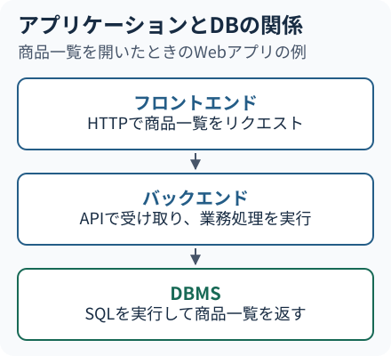
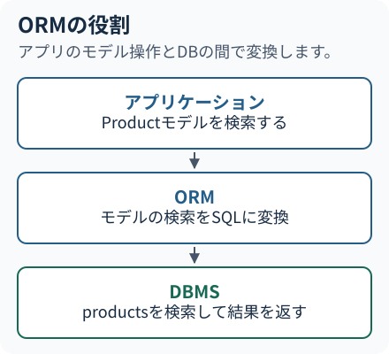
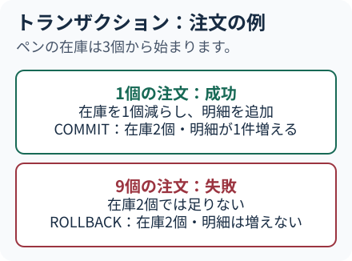

# 04 アプリケーションとの連携

[← 03 SQLの基本](03-sql.md) ｜ [目次に戻る](README.md) ｜ [05 チーム開発とデータベース管理 →](05-team.md)

## 必修｜画面・API・DBはどうつながるか



商品一覧を開くと、フロントエンドがバックエンドにリクエストします。たとえば `GET /products` を受け取ったバックエンドは、アプリの入力ルールや閲覧権限を確かめ、DBMSへSQLを渡します。その結果をJSONなどで画面へ返します。一般的なWebアプリではDBの接続情報をバックエンドで管理します。

LLMを使う場合の入力から回答までの構成は、[LLMアプリの設計](../llm/README.md#03-llmアプリの設計)を参照してください。

プログラムはドライバーやライブラリでDBへ接続します。SQLiteはファイルやメモリへ直接接続でき、MySQLやPostgreSQLでは通常、サーバーの接続先と認証情報を指定します。使い終わった接続は閉じます。

## 推奨｜ORMと直接SQLの違い



**ORM**は、テーブルの行とプログラム内のオブジェクトを対応付けます。よく使う登録や検索を同じ書き方にそろえやすい一方、発行されるSQLや余分な問い合わせに気づきにくいことがあります。直接SQLを書くと条件や結合が明確になりますが、結果の変換や共通処理は自分で整えます。どちらを使う場合も、制約、トランザクション、発行されたSQLを理解しておくと不具合を調べやすくなります。

## 必修｜注文と在庫更新を一緒に確定する

商品を1個注文するときは、在庫を減らす操作と注文明細の追加が必要です。これらを**トランザクション**にすると、両方成功したときだけ `COMMIT` で確定し、途中で失敗したときは `ROLLBACK` で取り消せます。



公式のPython 3を使います。リポジトリのルートで次を実行してください。Windowsでは `py -3`、macOSなどでは `python3` も使えます。

```bash
python docs/database/examples/order_transaction.py
```

[実行例のソース](examples/order_transaction.py)は既存の練習データをメモリに読み込みます。1個の注文はペンの在庫を3から2に減らし、明細を1件追加します。続く9個の注文は失敗し、在庫2と明細3件のままです。プログラム終了後にDBは残りません。

| 出力 | ペンの在庫 | 明細数 |
|---|---:|---:|
| 開始時 | 3 | 2 |
| 成功 | 2 | 3 |
| 取り消し | 2 | 3 |

例では「在庫が数量以上」を更新条件に含め、更新できたことを確認してから明細を追加します。SQLには入力値をパラメータで渡します。APIサーバーの用意は不要です。

<details>
<summary>発展｜注文を例にACIDを理解する</summary>

| 特性 | 注文で必要なこと |
|---|---|
| 原子性（Atomicity） | 在庫更新と明細登録をまとめて確定するか、両方取り消す。 |
| 一貫性（Consistency） | 正しい商品を参照し、在庫をマイナスにしないなど、決めたルールを守る。 |
| 分離性（Isolation） | 同時に注文が来ても、他の処理の途中結果を見て誤った判断をしないようにする。 |
| 永続性（Durability） | 永続ストレージのDBでは、確定した変更を障害後も復元できるようにする。メモリ上の教材DBは終了時に消える。 |

</details>

[Pythonのsqlite3](https://docs.python.org/ja/3/library/sqlite3.html)・[SQLiteのトランザクション](https://www.sqlite.org/lang_transaction.html)

---

[← 03 SQLの基本](03-sql.md) ｜ [目次に戻る](README.md) ｜ [05 チーム開発とデータベース管理 →](05-team.md)
