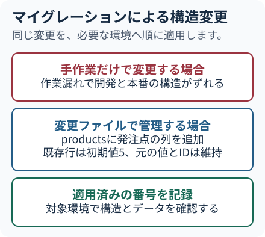
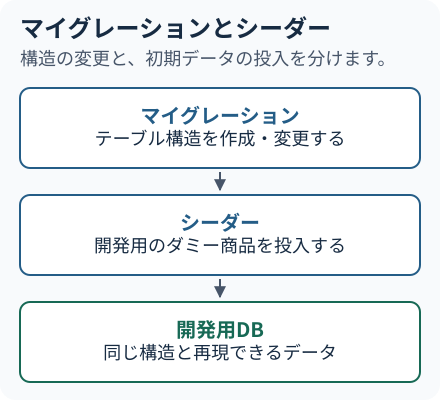
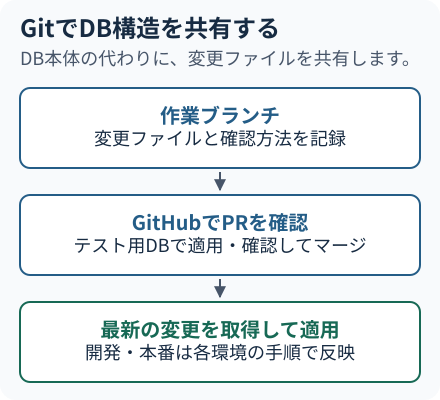

# 05 チーム開発とデータベース管理

[← 04 アプリケーションとの連携](04-application.md) ｜ [目次に戻る](README.md) ｜ [06 データベースのセキュリティ →](06-security.md)

## 必修｜構造と適用履歴を共有する

**スキーマ**はテーブル、列、制約などの構造です。各自がDBを手作業で変えると、同じコードでも開発やテストで使える列が異なることがあります。**マイグレーション**は「前の構造からどう変えるか」をファイルで記録し、順番に適用する仕組みです。

1. **作成**　既存データのあるDBと、空から作ったDBの両方で、必要な変更を適用できるようにします。
2. **確認**　旧データを含むテスト用DBに適用し、行数、ID、参照関係、アプリの読み書きを確かめます。
3. **管理**　適用済みの番号を記録し、共有済みの変更を直すときは新しい変更ファイルを追加します。並行して変更した場合は、順番や同じ表への影響を確認します。

[発注点を足すSQL](migrations/001-add-reorder-level.sql) は `products` に `reorder_level` を追加し、既存商品には初期値5を設定します。元のID、在庫、注文明細は保ちます。実行方法と確認は[演習3](exercise.md#演習3既存データを保って列を追加する)にまとめています。

## 必修｜環境とデータを分ける

| 環境 | 使うデータと目的 |
|---|---|
| 開発 | 各自の専用DBとダミーデータで試す |
| テスト | 同じ初期状態を作り、変更前後の結果を比較する |
| 本番 | 実際の利用データを扱う。変更範囲、権限、適用担当、復旧手順を確認する |

**シーダー**は、初期データや開発用のダミーデータを入れる仕組みです。この教材の [`sample.sql`](../sql/sample.sql) は構造と練習データを一度に用意します。チームで運用する場合は目的に応じて分け、何度実行しても重複しない方針や、空のDBで使う前提を明確にします。

## 推奨｜PRでレビューし、安全に反映する

Gitには、マイグレーション、スキーマ定義、ダミーデータ、検証手順を入れます。手元のDBファイル、実データ入りバックアップ、接続情報は、承認された保管先で管理します。PRには**変更の目的、対象の構造、既存データへの影響、確認結果、失敗時の復旧方法**を書きます。[03章のPRとレビュー](../03-team.md)

既存データがある場合は、列の追加、データの移行、アプリの切り替え、不要な列の削除を段階に分けられます。適用失敗時は、未確定のトランザクションを取り消せるか確認します。確定後は、修正用の変更や復元を検討します。列を消す逆操作で、消えた値まで戻るとは限りません。バックアップからの復元では、バックアップ後の更新が失われる可能性も考えます。

発展｜開発環境に合った道具を選ぶ

| 開発環境 | 選択肢 |
|---|---|
| Python・SQLAlchemy | [Alembic](https://alembic.sqlalchemy.org/) |
| PHP・Laravel | [Laravel Migration](https://laravel.com/docs/migrations) |
| SQLファイルを中心に運用するチーム | [Flyway](https://documentation.red-gate.com/flyway) |
| JavaScript・TypeScript・Prisma | [Prisma Migrate](https://www.prisma.io/docs/orm/prisma-migrate) |

自動で変更ファイルを生成できる場合も、適用順とデータへの影響はレビューします。

[SQLiteのALTER TABLE](https://sqlite.org/lang_altertable.html)

---

[← 04 アプリケーションとの連携](04-application.md) ｜ [目次に戻る](README.md) ｜ [06 データベースのセキュリティ →](06-security.md)
