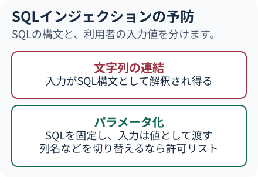
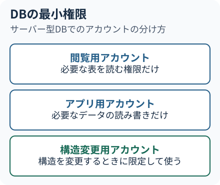

# 06 データベースのセキュリティ

[← 05 チーム開発とデータベース管理](05-team.md) ｜ [目次に戻る](README.md) ｜ [演習に進む →](exercise.md)

## 入力値とSQLを分ける

利用者が入力した文字をSQLの一部として組み立てると、DBMSが入力の一部を構文として解釈することがあります。これが**SQLインジェクション**が起きる仕組みです。商品検索ではSQLを固定し、検索する名前を**パラメータ**として別に渡します。



```python
def find_product(connection, name):
    return connection.execute(
        "SELECT id, name, stock FROM products WHERE name = ?",
        (name,),
    ).fetchall()
```

`?` は値を渡す場所です。`(name,)` は値が1つのタプルです。列名や並べ替えの方向を変更したい場合は、許可した固定の選択肢から選びます。ORMを使っていても、生のSQLを組み立てる箇所では同じ注意が必要です。[OWASPのSQLインジェクション対策](https://cheatsheetseries.owasp.org/cheatsheets/SQL_Injection_Prevention_Cheat_Sheet.html)

## 接続権限とデータの保管



サーバー型DBでは、アプリの接続アカウントに必要な表への読み書きだけを許可します。マイグレーションには別の権限を使い、開発・テスト・本番の認証情報も分けます。SQLiteでは、DBファイルへの直接アクセスをOSの権限で制限し、アプリ経由のアクセスをアプリの認証・認可で制御します。

接続情報はソースへ書かず、環境変数や承認された保管先から渡します。本番データや個人情報入りのDB・バックアップはGitに置かず、検証にはダミーデータを使います。共有対象と履歴を確認し、漏えい時は認証情報の失効を優先します。[Git・GitHubのセキュリティ](../08-security.md)

## バックアップと復元を確認する

バックアップをアクセス制限された場所に保存し、別の練習環境に復元して、必要なデータを読み出せるか確かめます。動作中のSQLiteファイルを単純にコピーする代わりに、SQLiteのバックアップ機能や適切な停止手順を使います。事故時にどこまで戻せるかは、バックアップの取得時刻と復旧の手順で決まります。[SQLiteのバックアップ](https://sqlite.org/backup.html)

## 開発時のチェックリスト

- [ ] 入力値をパラメータで渡し、列名などの選択は許可リストに限定した。
- [ ] 開発・テスト・本番を分け、接続アカウントの権限を確認した。
- [ ] 差分に接続情報、SQLiteの実データ、ログやバックアップが含まれていない。
- [ ] 構造変更の前に復旧手順を確認し、バックアップを別の環境に復元できた。

---

[← 05 チーム開発とデータベース管理](05-team.md) ｜ [目次に戻る](README.md) ｜ [演習に進む →](exercise.md)
