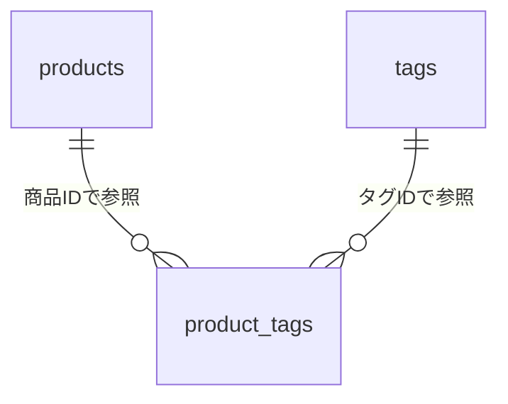

# データベースの基礎と実践｜回答例・解説

[← 演習に戻る](exercise.md) ｜ [補足教材の目次](README.md)

## 基本演習：商品を取得・追加・更新する

```sql
SELECT name, stock
FROM products
WHERE stock <= 5
ORDER BY stock, id;

INSERT INTO products (id, name, category, price, stock)
VALUES (4, '付箋', '文具', 220, 5);

UPDATE products SET stock = 9 WHERE id = 4;

SELECT id, name, stock FROM products ORDER BY id;
```

最初の検索は「マグカップ 2」「ペン 3」です。更新は主キーで対象を1件に絞ります。最後の結果で、ノート12、ペン3、マグカップ2が変わらず、付箋が9になったことを確認します。

## 応用演習：商品とタグを設計する



```sql
CREATE TABLE tags (
    id INTEGER PRIMARY KEY,
    name TEXT NOT NULL UNIQUE
);

CREATE TABLE product_tags (
    product_id INTEGER NOT NULL REFERENCES products(id),
    tag_id INTEGER NOT NULL REFERENCES tags(id),
    PRIMARY KEY (product_id, tag_id)
);

INSERT INTO tags (id, name) VALUES (1, '学習用'), (2, '定番');
INSERT INTO product_tags (product_id, tag_id) VALUES (2, 1), (2, 2), (1, 1);

SELECT p.name
FROM products AS p
JOIN product_tags AS pt ON pt.product_id = p.id
JOIN tags AS t ON t.id = pt.tag_id
WHERE t.name = '学習用'
ORDER BY p.id;
```

結果は「ノート」「ペン」です。中間テーブルの主キーをIDの組にすることで、同じ商品とタグを重複して登録できません。タグ名は `tags` の1箇所で変更できます。

## 発展演習：既存データを保って列を追加する

SQLite CLIの `.read migrations/001-add-reorder-level.sql` で変更を適用します。`.read` はSQLite CLIのコマンドです。続けて以下を実行します。

```sql
SELECT id, stock, reorder_level FROM products ORDER BY id;
SELECT id, product_id, quantity FROM order_items ORDER BY id;
SELECT version FROM schema_migrations;
PRAGMA foreign_key_check;
```

商品は順に「1・12・5」「2・3・5」「3・2・5」です。明細は「1・2・4」「2・3・1」のままで、適用履歴には `001-add-reorder-level` が1件あります。外部キー検査は違反がなければ0行です。`reorder-before.db` では商品ID・在庫と明細の値を比較できます。

**PRの記入例**　「発注点を管理する列を追加しました。既存3商品は初期値5で、ID・在庫と明細2件は変更なしです。練習DBで適用履歴と外部キーを確認しました。失敗した場合は適用を中断し、確定の有無を確認します。未確定なら取り消し、確定済みなら修正用の変更や保管したコピーからの復元を検討します。」

変更をトランザクション内で実行し、適用番号の重複を検出できるようにしています。練習用の変更ファイルと確認結果を共有すれば、DB本体をGitに入れずにチームで追跡できます。

---

[← 演習に戻る](exercise.md) ｜ [補足教材の目次](README.md)
