# LLMを使ったアプリの設計入門｜補足教材

[← 教材トップ](../../README.md#補足教材) ｜ [実装例](implementation.md) ｜ [ミニ演習](exercise.md)

Git・SQL教材を読んで答える学習アシスタントを題材に、LLMの仕組みから実装・評価まで学びます。本文と演習、Pythonのキーワード検索は、外部アカウントやAPIキーなしで取り組めます。

| 節 | 学ぶこと | 目安 |
|---|---|---:|
| [01 LLMの基礎](#01-llmの基礎) | トークン、Attention、学習と推論 | 10〜15分 |
| [02 LLMの利用方法](#02-llmの利用方法) | クラウドとローカル、API、生成設定 | 8〜12分 |
| [03 LLMアプリの設計](#03-llmアプリの設計) | 入出力、根拠、会話履歴 | 10〜15分 |
| [04 RAG](#04-rag) | 検索、Embedding、出典 | 15〜20分 |
| [05 AIエージェント](#05-aiエージェント) | Tool CallingとMCP | 10〜15分 |
| [06 評価と運用](#06-評価と運用) | 評価用の質問、費用、情報管理 | 10〜15分 |
| [07 実装例](#07-実装例) | PythonとOllamaで動かす | 10〜15分 |

実装から試す場合は07節から始め、仕組みが気になったら03・04節に戻れます。実装の時間目安にモデルのダウンロードは含みません。

## 01 LLMの基礎

**AI**は知的な処理を行う技術の総称です。その一分野の**機械学習**はデータから規則性を学び、**深層学習**は多層のニューラルネットを使う方法です。**生成AI**は文章・画像・音声などを生成する能力に着目した呼び方で、文章を生成するLLM（大規模言語モデル）はその代表例です。

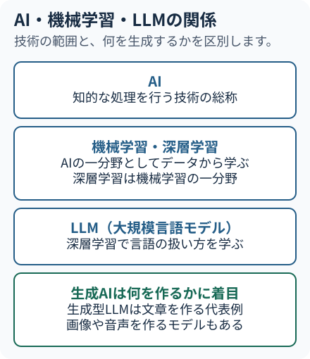

### トークンとAttention

LLMは文章を**トークン**という小さな単位に分け、入力に続く候補を予測します。選んだトークンを加えて予測を繰り返し、文を作ります。図の分割と確率は説明用です。実際の分割や候補はモデルによって異なります。

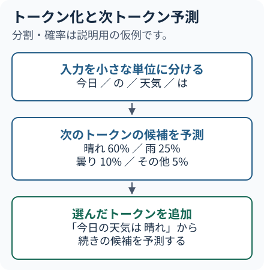

多くのLLMは**Transformer**という構造を使います。その中の**Attention**は、文章のどの位置にある情報をどれくらい参照するかを計算する仕組みです。たとえば「猫が魚を食べた」では「食べた」を理解する助けに「猫が」「魚を」の情報を使います。

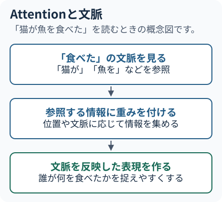

### 学習と推論

**学習**ではデータを使ってモデルの内部パラメータを調整します。**推論**では学習済みのモデルに質問や資料を渡して回答を生成します。RAGで教材を添えるのは推論時の処理です。

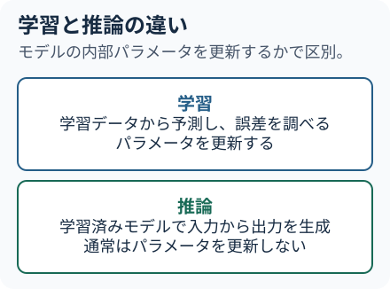

一度に扱えるトークンの範囲を**コンテキストウィンドウ**と呼びます。指示、会話履歴、教材の抜粋、今回の質問、生成する回答に使う分を考え、資料や履歴を絞ります。上限や数え方はモデルやAPIの仕様を確認します。

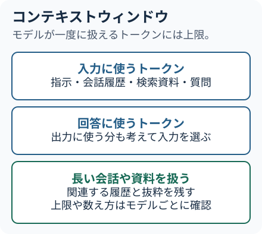

文章が自然でも、教材にない提出日を答えるなど、根拠のない内容が生成されることがあります。これを**ハルシネーション**と呼びます。回答と出典の本文を照らして確認します。[Transformerの原論文](https://arxiv.org/abs/1706.03762)

## 02 LLMの利用方法

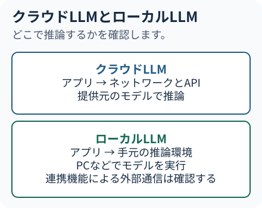

| 観点 | クラウドLLM | ローカルLLM |
|---|---|---|
| 使い始め方 | 提供元のサービスやAPIを使う。 | PCに実行環境とモデルを用意する。 |
| 費用と性能 | API料金や速度を用途に合わせて確認する。 | PCのメモリ・速度・ストレージを確認する。 |
| データの扱い | 送信範囲と提供元の取り扱いを確認する。 | 手元で推論しても、追加の連携先やログを確認する。 |

APIにはモデル名とメッセージ、必要に応じて生成設定を渡します。**Temperature**は選ばれるトークンのばらつきを調整する設定で、低い値では一般に候補が絞られます。出力が一定になることや、正確であることは別に確認します。モデルは、同じ質問で日本語の回答、文脈の長さ、出典、費用、応答時間を比較して選びます。実装例では手元のOllamaにHTTPで送信します。[Ollama Chat API](https://docs.ollama.com/api/chat)・[Ollamaの生成設定](https://docs.ollama.com/modelfile#valid-parameters-and-values)

## 03 LLMアプリの設計

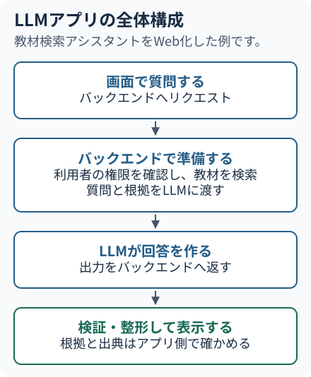

アプリを作るときは、誰のどの質問に答えるかを先に決めます。このアシスタントはGit・SQLの初学者向けです。目次を探すだけなら検索で十分で、理由や手順を説明するときにLLMを使えます。Web化する場合の画面・バックエンド・DBの役割は、[データベース補足のアプリ連携](../database/04-application.md)を参照してください。

### モデルに渡す情報と回答の形式

入力は「役割と回答ルール」「受講者の質問」「参照資料」に分けます。「結論・補足・出典の順で答える」「資料が足りなければ確認質問を1つ返す」など、利用者に返したい内容を具体的に指定します。

| 項目 | 「git add . をするとGitHubに反映される？」への回答例 |
|---|---|
| 結論 | `git add .` は、変更を次のコミットに含める準備をする操作です。 |
| 補足 | `git commit` で履歴に記録し、`git push` でGitHubに送ります。 |
| 出典 | [01 基本操作の「add → commit → push」](../01-basic.md#1-6-add--commit--pushでgithubに反映する) |

プログラムが回答を処理する場合は、`status`（回答・確認質問・根拠不足）、`answer`（本文）、`sources`（出典ID）などに分ける**構造化出力**が役立ちます。対応するAPIで形式を指定できる場合も、項目や型と、出典IDが取得済み資料のものかをアプリ側で検査します。会話履歴はすべて送り続けず、今回の質問に必要な発言を選び、保存する範囲も決めます。[Ollamaの構造化出力](https://docs.ollama.com/capabilities/structured-outputs)

## 04 RAG

**RAG（検索拡張生成）**では、質問に関係する資料を探し、本文を質問と一緒にモデルへ渡します。回答に出す出典は、取得した資料のリンクから選びます。

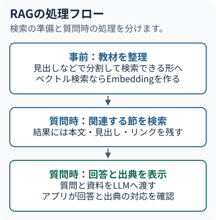

### 資料の分け方と検索方法を選ぶ

検索用に分けた本文を**チャンク**と呼びます。教材なら見出し単位で分け、手順やコードブロックを途中で切らず、ファイル名・見出し・リンクを残します。該当する抜粋を少数選ぶと、コンテキスト内に根拠を収めやすくなります。

| 検索方法 | 向いている質問 |
|---|---|
| キーワード検索 | `git restore --staged` など正確なコマンド名が分かる。 |
| ベクトル検索 | 「選んだファイルをコミットの対象から外したい」など別の表現で尋ねる。 |
| 両方を組み合わせる | コマンド名は一致を重視し、言い換えは意味の近さも使いたい。 |

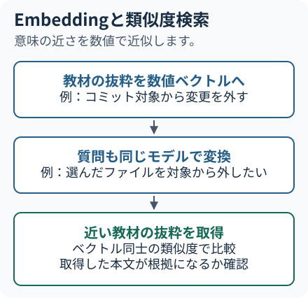

**Embedding**は、文章を比較できる数値の並び（ベクトル）に変換したものです。同じモデルで教材と質問を変換して類似度を比較します。最も近い節でも、正しい根拠が含まれるかは別に確かめます。少数の節ならメモリ内で比較でき、量が増えて永続化や高速な検索が必要になったときにベクトルDBを検討します。[データベースの種類](../database/01-basics.md)・[OllamaのEmbedding API](https://docs.ollama.com/api/embed)

### プロンプト・RAG・追加学習の使い分け

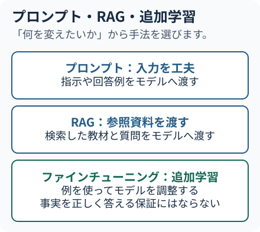

回答の長さや形式をそろえるならプロンプトから始めます。更新した教材を根拠に回答するなら、検索対象を更新できるRAGが候補です。特定の分類や文体を繰り返し出したい場合は、ファインチューニングを検討します。

## 05 AIエージェント

教材検索アプリのように処理の順序を固定する設計もあれば、目標に応じてモデルが次に使うツールを提案し、結果を見て次の操作を選ぶ設計もあります。後者を**AIエージェント**と呼ぶことがあります。

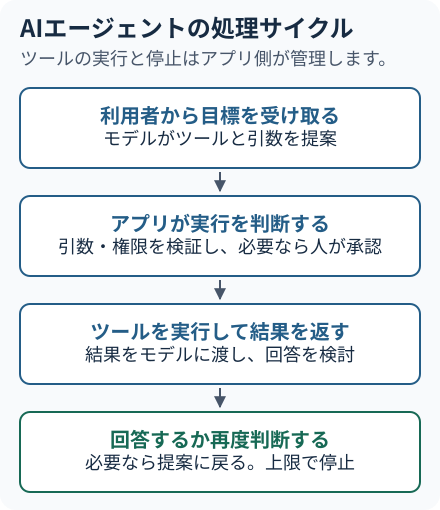

**Tool Calling（Function Calling）**では、モデルがツール名や引数を提案し、アプリが検証して実行します。教材検索なら許可した資料の読み取りだけで足ります。書き込み・外部送信などの操作は用途を決め、必要に応じて人が承認します。反復の上限と停止条件も決めます。[OllamaのTool Calling](https://docs.ollama.com/capabilities/tool-calling)・[08章のAIツール利用時の権限](../08-security.md#8-8-ai開発支援ツールを安全に使う)

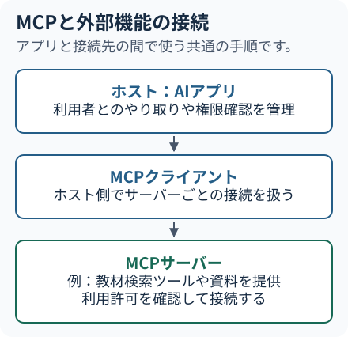

**MCP（Model Context Protocol）**は、AIアプリと外部のツールや資料を提供するサーバーをつなぐための共通仕様です。ホストが接続先と許可範囲を管理します。**マルチエージェント**では、たとえば資料を探す役と出典を確認する役に分けます。役割が増えると、引き継ぐデータと責任、費用や待ち時間も確認する必要があります。[MCPのアーキテクチャ](https://modelcontextprotocol.io/docs/learn/architecture)

## 06 評価と運用

質問ごとに「期待する回答」「参照すべき見出し」「避けたい誤り」を残します。調整用と最後の確認用の質問を分け、正しい根拠がある例、言い換えた例、曖昧な例、根拠がない例を含めます。

| 評価すること | 確認方法 |
|---|---|
| 検索精度 | 上位結果に必要な節が含まれた質問数を数える。 |
| 回答精度 | 結論と出典を別々に確認し、出典の本文が本当に結論を支えているか読む。 |
| 根拠がない場合 | 「提出期限は？」のように教材に答えがない質問で、日付を作らず、確認先を案内するか確かめる。 |
| 障害時の応答 | 検索に失敗したら追加情報を尋ねる。生成がタイムアウトしたら取得済みの資料を表示する。 |

10問中8問で正しい節が見つかっても、回答と出典の両方が正しいのが6問なら、検索と生成を別々に改善できます。教材を更新したら索引を更新し、同じ質問で再評価します。

クラウドAPIの費用は入力・出力トークン数と単価から概算し、Embeddingや検索基盤の費用も必要に応じて足します。変更前後で同じ質問を使い、検索・生成にかかる時間と正答率を比較します。

検索した資料に操作を促す文が紛れる**プロンプトインジェクション**を想定し、資料の内容を許可の根拠にしません。APIキーや個人情報は送信・記録せず、利用者が閲覧できる資料だけを検索対象にします。[08章のAIツールと秘密情報の管理](../08-security.md#8-8-ai開発支援ツールを安全に使う)

## 07 実装例

[Pythonの実装例](implementation.md)では、まずキーワードで3つの教材の節を探します。Ollamaを用意すると、同じ抜粋を使った回答生成や、Embeddingで言い換えの候補を探す仕組みも試せます。

---

[← 教材トップ](../../README.md#補足教材) ｜ [ミニ演習に進む](exercise.md) ｜ [回答例と評価の観点](answer.md)
