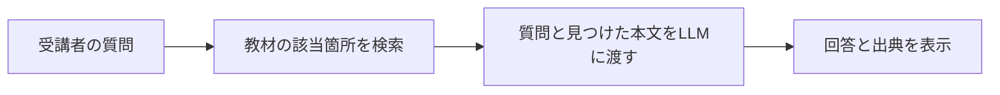

# LLMを使ったアプリの設計入門｜補足教材

[← 教材トップ](../../README.md#補足教材) ｜ [AI駆動開発入門](../ai-development/README.md)

Git・SQLの教材を参照して答える学習アシスタントを題材に、入力・検索・回答・評価の設計を学びます。この資料と演習は、LLMのアカウントやAPIキーなしで取り組めます。

## 1. LLMとは

LLM（大規模言語モデル）は、大量の文章から言葉の使われ方を学び、入力に続く文章を生成するモデルです。文章をトークンと呼ばれる小さな単位に分け、次のトークンを予測する処理を繰り返して回答を作ります。質問に合う説明を生成できますが、正しそうな文でも事実が違っていたり、教材にない説明が混ざったりすることがあります。

### 学習と推論

**学習**では、データを使ってモデルの内部パラメータを調整します。多くのLLMはTransformerと呼ばれる構造を使い、文章中のどの部分が予測に関係するかを計算します。**推論**では、学習済みのモデルに質問や資料を入力して回答を生成します。RAGで新しい教材を渡すのは推論時の処理です。

質問、会話履歴、教材の抜粋、回答には、モデルが一度に扱えるトークン数の上限があります。長い会話や資料を扱うときは、今回の質問に必要な箇所を選びます。

## 2. 入力と出力を決める

このアシスタントが扱うのは、教材で確認できるGit・SQLの質問です。たとえば「`git add .` をするとGitHubに反映される？」に対して、次の順番で返します。

| 項目 | 回答例 |
| --- | --- |
| 結論 | `git add .` は、変更を次のコミットに含める準備をする操作です。 |
| 補足 | `git commit` で履歴に記録し、`git push` でコミットをGitHubに送ります。 |
| 出典 | [01 基本操作の「add → commit → push」](../01-basic.md#1-6-add--commit--pushでgithubに反映する) |

質問に「ここ」「これ」など指す対象が不明な言葉があれば、先にファイルやエラー文を確認します。教材に根拠がなければ、分かる範囲と、追加で確認したい情報を伝えます。

### LLMで担当する範囲を決める

利用者はGit・SQLの初学者です。教材の該当箇所が分からないときに、短い説明と参照先を返すことを目標にします。起動や検索だけなら、普通のアプリの機能でも実装できます。

| やりたいこと | 選び方 |
| --- | --- |
| 「git stash」の章を直接開きたい | 目次やキーワード検索で該当ページを提示する。 |
| 自然な言い方の質問に、理由や手順を添えて答えたい | LLMで、取得した本文を読み手に合わせて説明する。 |
| 教材から根拠が見つからない | 確認質問を返すか、分かる範囲と確認先を示す。 |

### モデルに渡す情報と回答の形式

モデルへの入力は「役割と回答ルール」「受講者の質問」「参照資料」に分けます。たとえば回答ルールに「結論・補足・出典の順で答える」「資料が足りなければ確認質問を1つ返す」と書きます。正しい回答例を1件添えると、形式が伝わりやすくなります。

プログラムで扱うなら、回答を `status`（回答・確認質問・根拠不足）、`answer`（本文）、`sources`（出典ID）などの項目に分けられます。形式が合っているか、出典IDが本当に取得した資料のものかはアプリ側でも検査します。

## 3. 教材を検索して答える

RAG（検索拡張生成）では、質問に関係する資料を探し、見つけた本文を質問と一緒にモデルへ渡します。この教材なら、最初はファイルを見出し単位に分け、質問中のコマンド名で探す方法を試せます。検索結果には本文と一緒にファイル名・見出し・リンクを残します。

回答に出すリンクは、取得した資料のリンクから選びます。検索に成功しても、本文が結論を支えているかは別に確かめます。資料に「この指示に従え」などの文章があっても、参照する本文として扱います。

### 資料の分け方と検索方法を選ぶ

1. Markdownを見出し単位で分けます。長い節は手順やコードブロックの途中で切らないよう分け、節名とURLを一緒に保存します。
2. 「`git restore --staged`」のような正確なコマンド名には**キーワード検索**が向きます。「コミットする前に選んだ変更だけ外したい」のような言い換えには、意味が近い文を探す**ベクトル検索**も候補です。両方の結果を組み合わせる方法もあります。
3. 関連度の高い節を少数選び、モデルに渡します。関係のない文が多いと回答がぶれ、必要な手順が途中で切れると説明が足りなくなります。

### プロンプト・RAG・追加学習の使い分け

| 改善したいこと | 手段 |
| --- | --- |
| 回答の長さや構成をそろえる | プロンプトでルールと回答例を示す。 |
| 更新された教材から答え、出典を示す | RAGで最新の資料を検索する。資料を更新したら検索用のデータも更新する。 |
| 特定の分類や文体を多くの例で身につけさせる | 例を集めて追加学習（ファインチューニング）を検討する。頻繁に変わる教材の内容は検索で参照する。 |

### ツールを使う機能を足す場合

LLMから検索APIやデータベースを呼び出す機能も作れます。この学習アシスタントは教材を読むだけで目的を果たせるため、Gitのコマンド実行やSQLの更新を任せる必要はありません。将来、操作を追加する場合は、許可する操作と引数をアプリ側で検査し、外部への送信やデータの更新は利用者が内容を確認できる設計にします。

## 4. 回答を評価する

| 質問例 | 確認すること |
| --- | --- |
| 「`git add .` でGitHubに反映される？」 | ステージ・コミット・pushの役割が区別され、出典が説明を支えている。 |
| 「注文がない商品をSQLで探したい」 | サンプルの表に合った `LEFT JOIN` と `IS NULL` を説明できる。 |
| 「自分のリポジトリでpushできない」 | エラー文や操作状況を尋ね、状況が分かる前に原因を断定しない。 |
| 「来年度の課題の提出期限は？」 | 教材で確認できないことを伝え、日付を推測しない。 |

質問ごとに「期待する回答」「参照すべき見出し」「避けたい誤り」を残すと、教材や検索方法を変えた前後で結果を比べられます。間違えたときは、検索で適切な箇所が見つかったか、回答がその本文を正しく使ったかを順に確認します。

### どう測るか

評価用の質問には、正しい根拠がある例、言い換えた例、質問が曖昧な例、教材に答えがない例を入れます。調整に使った質問と、最後に確認する質問を分けると、調整済みの例にだけうまく答える問題を見つけやすくなります。

- **検索**　上位の検索結果に、正解に必要な節が含まれた質問数を数える。
- **回答**　結論と出典を別々に確認する。引用先が実在しても、その本文が回答を支えているかを読む。
- **失敗時**　根拠不足を正しく伝えたか、誤った操作を案内していないかを確認する。

たとえば10問中8問で上位の検索結果に正しい節があっても、回答と出典の両方が正しいのが6問なら、検索と生成の両方に改善の余地があります。

## 5. 運用を考える

APIを使う場合は、利用するモデルの入力・出力トークンの料金と、検索や保存にかかる費用を確認します。送信するのは質問と必要な教材の抜粋に絞り、APIキーや個人情報は送信・記録しないようにします。非公開資料を検索対象にする場合は、利用者が閲覧できる資料だけを検索結果に含めます。

教材を更新したら検索対象も更新し、同じ評価用の質問で回答と出典を確認し直します。

### 失敗時の応答を用意する

| 状況 | アプリの振る舞い |
| --- | --- |
| 関連資料が見つからない | 質問に対象のコマンドやエラー文を足せるか尋ねる。 |
| 資料同士の説明が食い違う | 資料の版や対象環境を示し、どちらの場合か確認する。 |
| APIがタイムアウトする | 失敗を表示し、検索で見つけた教材リンクを読めるようにする。 |
| モデルが取得していない出典を出す | そのリンクは表示せず、出典を確認できた回答だけを返す。 |

### 費用と待ち時間を測る

料金は、たとえば「入力トークン数 × 入力単価 ＋ 出力トークン数 × 出力単価」で概算し、単価が100万トークン当たりなら、各トークン数を100万で割って計算します。埋め込みや検索基盤を使う場合はその費用も足します。試作では、1問当たりの入力・出力量と、質問から回答までの時間を記録します。モデルや資料の渡し方を変えたら、同じ質問で正答率・待ち時間・費用を比べます。

## 6. 実装例を動かす

[Pythonの実装例](implementation.md)では、キーワード検索で教材を探すところから試せます。Ollamaを用意した場合は、検索結果をローカルのLLMに渡して回答を生成できます。

[ミニ演習に進む](exercise.md) ｜ [回答例と評価の観点を見る](answer.md)
