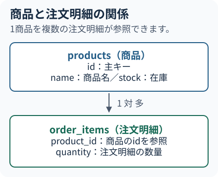
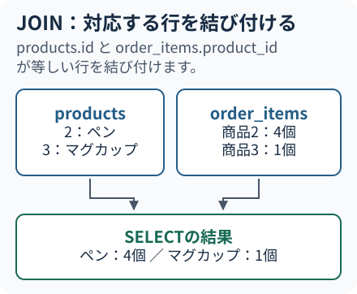

# SQL入門｜補足教材

DBの設計からアプリ連携、チームでの運用まで学ぶ場合は、[データベースの基礎と実践](../database/README.md)を参照してください。

[← 教材トップ](../../README.md)

商品と注文明細のサンプルを使って、SQLiteでデータの検索・追加・更新・削除を練習し、最後に集計と結合を試します。

## この教材でできるようになること

- 必要な列や行を選び、結果を並べ替える。
- 変更前に対象の行を確認し、追加・更新・削除を試す。
- グループごとに集計し、別のテーブルと結び付ける。

参考：情報システム工学科3年春 データベース工学

## 1. SQLとは

SQLは、データベースに「どのデータを読みたいか」「どのデータを追加・変更したいか」を伝える言語です。たとえば、在庫の少ない商品を探したり、カテゴリごとの在庫を集計したりできます。この教材では、SQLを実行するデータベースとして **SQLite** を使います。

データは**テーブル（表）**に入っています。下は `products`（商品テーブル）の一部です。

| id | name | stock |
|---:|---|---:|
| 1 | ノート | 12 |
| 2 | ペン | 3 |

1行が商品1件、1列が商品名や在庫数などの項目です。`id` は商品を一意に識別する**主キー**です。別の表 `order_items`（注文明細）では、`product_id` に対応する商品の `id` を記録します。

### DBMS、データモデル、スキーマ

DBMSは、データの保存・検索・更新を管理するソフトウェアです。利用者やアプリがSQLで問い合わせると、DBMSが解釈して処理し、結果を返します。SQLiteやPostgreSQLは関係データベースの例です。データの用途によっては、文書やグラフなど別のモデルも使われます。

- **概念モデル**では商品や注文明細といった対象とその関係を整理します。ER図では「1商品を複数の注文明細から参照できる」という1対多の関係を表せます。


- **論理モデル**では、表・列・キーを決めます。正規化では列に複数の値を詰め込まず、キーの一部やキー以外の項目に依存する情報を別表に分けます。明細に商品名を何度も記録せず、商品表にまとめると、名前の更新箇所を1つにできます。
- **物理設計**では、利用するDBMSのデータ型やインデックスなどを選びます。スキーマは、テーブルや制約など、DBMSに定義する構造です。

## 2. 基本のSQL文

| SQL文・句 | 何を指定するか |
|---|---|
| `CREATE TABLE` | テーブル名、列名、列の型などを定義する。 |
| `SELECT … FROM …` | どのテーブルから、どの列を表示するかを指定する。 |
| `WHERE` | どの行を対象にするかを絞る。たとえば `stock <= 5` は在庫が5個以下の行。 |
| `ORDER BY` | 並べ替えに使う列を指定する。`ASC` は昇順、`DESC` は降順。 |
| `INSERT INTO … VALUES …` | 指定した列に値を入れて、新しい行を追加する。 |
| `UPDATE … SET …` | 既存の行の値を変更する。 |
| `DELETE FROM …` | 指定したテーブルから行を削除する。 |
| `GROUP BY` | 同じ値を持つ行をまとめ、`COUNT`（件数）や `SUM`（合計）で集計する。 |
| `JOIN … ON …` | `ON` の条件に従って、別々のテーブルの行を結び付ける。 |

`WHERE` を省いた `UPDATE` や `DELETE` は全行が対象です。先に同じ条件の `SELECT` で対象を確認します。

### データ型と制約

`CREATE TABLE` のように構造を定義する文をDDL、`INSERT`、`UPDATE`、`DELETE` のようにデータを操作する文をDMLと呼びます。`SELECT` は検索の文です。

サンプルでは数値に `INTEGER`、文字列に `TEXT` を使います。`PRIMARY KEY` は行を一意に識別し、`FOREIGN KEY`（列定義では `REFERENCES`）は別の表のキーを参照します。複数の列を組み合わせた複合キーも指定できます。`NOT NULL` は値の欠落を禁止し、`UNIQUE` は値の重複を制限し、`CHECK` は値が条件を満たすか確認します。SQLiteでは外部キー制約の検査を接続ごとに `PRAGMA foreign_keys = ON;` で有効にします。

### 検索を組み立てる語句

| 用途 | SQLの例 |
|---|---|
| 条件の組み合わせ | `AND`、`OR`、`NOT`。かっこで条件をまとめられる。 |
| 比較・計算 | `=`、`<>`、`>=` で比較し、`+`、`-`、`*`、`/` で計算する。 |
| 範囲・候補・パターン | `BETWEEN` は両端を含む範囲、`IN` は候補との一致、`LIKE` は文字列のパターン（`%` は任意の長さ、`_` は1文字）。 |
| 値が未設定か確認 | `IS NULL` または `IS NOT NULL` を使う。`NULL` は0や空文字とは異なる。 |
| 関数 | `LENGTH(name)` は行ごとの文字数、`AVG(price)` は複数行の平均。`COUNT(*)` は行数、`COUNT(列名)` はその列がNULLでない行数。 |
| 集計結果の絞り込み | `WHERE` は集計前の行、`HAVING` は集計後のグループを絞る。 |
| 表示件数の調整 | SQLiteでは `ORDER BY` の後に `LIMIT 件数 OFFSET 飛ばす件数` を書く。資料にある `OFFSET … FETCH` は別のSQL方言の書き方。 |
| 副問い合わせと集合演算 | `SELECT` の中に別の問い合わせを書ける。`UNION` は結果の和集合、`INTERSECT` は共通部分、`EXCEPT` は差集合を返す。 |
| 結合の種類 | `INNER JOIN` は一致した組、`LEFT JOIN` は左の全行、`RIGHT JOIN` は右の全行を残す。外部結合では相手がない列がNULLになる。`CROSS JOIN` は全組み合わせを作る。 |

### トランザクションとアプリからの利用

一連の変更をひとまとまりに扱う仕組みが**トランザクション**です。`BEGIN` で開始し、`COMMIT` で確定、`ROLLBACK` で取り消します。DBMSは同時実行を制御し、製品に応じてロックやジャーナルを使ってデータの整合性や障害時の復旧を支えます。ロックを互いに待つとデッドロックになる場合があります。

アプリからは、接続してSQLを準備し、引数を設定して実行し、結果を読み取って接続などを閉じます。JavaのJDBCでは `Connection`、`PreparedStatement`、`ResultSet` がこの流れに対応します。入力値を渡すときは `?` などのプレースホルダーに値をバインドします。

## 3. 実際に動かしてみよう

### 準備：ブラウザでSQLiteを開く

インストールせずに始める場合は、[SQLite Fiddle](https://sqlite.org/fiddle/)を開きます。

1. SQLの入力欄に `SELECT 2 + 3 AS result;` と入力し、**Run** を押します。出力に `5` が表示されれば準備できています。
2. [練習用データ（sample.sql）](sample.sql)を開き、ファイルの中身をすべてコピーします。Fiddleに戻り、入力欄の内容を置き換えて **Run** を押します。最後の `SELECT` で商品一覧が表示されます。
3. 同じタブの入力欄を次のSQLに置き換えて **Run** を押します。結果が `3` なら、商品データが読み込まれています。

   ```sql
   SELECT COUNT(*) AS product_count FROM products;
   ```

   **実行結果**

   | product_count |
   | --- |
   | 3 |

次のSQLで、読み込んだ商品テーブルを表示できます。画面の出力を下の実行結果と見比べてください。

```sql
SELECT * FROM products ORDER BY id;
```

| id | name | category | price | stock |
| --- | --- | --- | --- | --- |
| 1 | ノート | 文具 | 300 | 12 |
| 2 | ペン | 文具 | 150 | 3 |
| 3 | マグカップ | 雑貨 | 800 | 2 |

この後のSQL例も、同じタブで入力欄を置き換えて実行します。`no such table: products` と表示されたら、練習用データを読み込み直してください。最初からやり直す場合は新しいタブでFiddleを開き、練習用データを読み込みます。

#### `table products already exists` と表示されたら

同じセッションに商品テーブルがすでにあります。入力欄から `sample.sql` の内容を消し、次の確認用SQLだけを実行します。

```sql
SELECT COUNT(*) AS product_count FROM products;
SELECT COUNT(*) AS order_item_count FROM order_items;
```

商品が3件、注文明細が2件なら、そのまま次のSQL例に進めます。エラーが出たり件数が違ったりする場合は、新しいタブでFiddleを開き、`sample.sql` を1回だけ実行してから確認し直します。

<details>
<summary>PCにSQLiteを入れてVSCodeから試す方法</summary>


SQLiteは、ターミナルで `sqlite3` を起動するとSQLを入力できるようになります。以下ではVSCodeのターミナルを使います。GitHub上で教材を読んでいる場合は、[練習用データ](sample.sql)をPCに保存するか、このリポジトリをクローンしておきます。

1. VSCodeで **ファイル → フォルダーを開く** を選び、`sample.sql` のある `docs/sql` フォルダを開きます。サンプルだけを保存した場合は、その保存先を開きます。
2. **ターミナル → 新しいターミナル** を選びます。
3. `sqlite3 --version` を入力します。バージョンが表示されたら `sqlite3 :memory:` で起動します。コマンドが見つからない場合は、以下のOS別手順に進みます。

#### Windowsでコマンドが見つからない場合

[SQLite公式のダウンロードページ](https://www.sqlite.org/download.html)の **Precompiled Binaries for Windows** から、PCに合う `sqlite-tools-win-…zip` を入手して展開します。エクスプローラーで展開先の `sqlite3.exe` を右クリックして「パスのコピー」を選びます。VSCodeのターミナル（PowerShell）で、例のパスをコピーしたパスに置き換えて実行します。

```powershell
& "C:\Tools\sqlite3.exe" --version
& "C:\Tools\sqlite3.exe" :memory:
```

#### macOSでコマンドが見つからない場合

Homebrewを使っている場合は `brew install sqlite` で導入できます。導入後、`"$(brew --prefix sqlite)/bin/sqlite3" --version` で確認し、`"$(brew --prefix sqlite)/bin/sqlite3" :memory:` で起動します。Homebrewを使っていない場合は、[SQLite公式のダウンロードページ](https://www.sqlite.org/download.html)の macOS用 `sqlite-tools-osx-…zip` を入手して展開し、展開したフォルダ内の `sqlite3` をFinderからVSCodeのターミナルにドラッグします。入力された実行ファイルのパスの後に半角スペースと `:memory:` を付けて実行します。

#### 練習データを読み込む

`sqlite>` と表示されたらSQLiteが開いています。そこに次の3行を1行ずつ入力します。

```text
.read sample.sql
.headers on
.mode column
```

データはメモリ上に作られ、`.quit` で終了すると消えます。最初からやり直すには、起動と読み込みを繰り返します。

SQL文の末尾には `;` を付けます。`.read` など、ドットで始まる行はSQLiteのコマンドライン専用の操作なので、末尾の `;` は不要です。

準備ができたら、`.tables` を実行し、`products` と `order_items` があることを確かめます。`.schema products` では、サンプルの `CREATE TABLE` 文を確認できます。

</details>

### ステップ1：データを読む（SELECT）

まず、商品名と価格を表示します。

```sql
SELECT name, price
FROM products
ORDER BY id;
```

**実行結果**

| name | price |
| --- | --- |
| ノート | 300 |
| ペン | 150 |
| マグカップ | 800 |

`SELECT` の後に表示する列、`FROM` の後に表の名前を書きます。この例ではノート、ペン、マグカップの順に表示されます。全列を見たい場合は、列名の代わりに `*` を指定します。

次に、在庫が5個以下の商品を、在庫の少ない順に表示します。

```sql
SELECT name, stock
FROM products
WHERE stock <= 5
ORDER BY stock ASC;
```

`WHERE` は行を絞り込む条件、`ORDER BY` は並び順です。`ASC` は昇順、`DESC` は降順です。この例ではマグカップ（2個）、ペン（3個）の順に表示されます。

| name | stock |
| --- | --- |
| マグカップ | 2 |
| ペン | 3 |

### ステップ2：データを追加・更新・削除する

以下は同じSQLiteセッションで、ブロックを上から順に実行します。`BEGIN` から `ROLLBACK` までを1組として実行すると、最後に練習前の状態に戻ります。

#### 追加（INSERT）

```sql
BEGIN;

INSERT INTO products (id, name, category, price, stock)
VALUES (4, '消しゴム', '文具', 100, 8);

SELECT id, name, stock FROM products WHERE id = 4;
```

**実行結果**

| id | name | stock |
| --- | --- | --- |
| 4 | 消しゴム | 8 |

`INSERT INTO` で表と列を指定し、`VALUES` に同じ順序で値を書きます。最後の検索で、消しゴムの在庫が8個と表示されます。

#### 更新（UPDATE）

```sql
SELECT id, name, stock FROM products WHERE id = 4;

UPDATE products
SET stock = 10
WHERE id = 4;

SELECT id, name, stock FROM products WHERE id = 4;
```

**変更前の結果**

| id | name | stock |
| --- | --- | --- |
| 4 | 消しゴム | 8 |

**変更後の結果**

| id | name | stock |
| --- | --- | --- |
| 4 | 消しゴム | 10 |

`SET` で変更する列と値を書きます。更新前は8個、更新後は10個と表示されます。

#### 削除（DELETE）

```sql
SELECT id, name FROM products WHERE id = 4;

DELETE FROM products
WHERE id = 4;

SELECT id, name FROM products WHERE id = 4;

ROLLBACK;
```

**変更前の結果**

| id | name |
| --- | --- |
| 4 | 消しゴム |

**変更後の結果**

**実行結果：0行**

削除後の検索では該当する行が表示されません。`ROLLBACK` で `BEGIN` 以降の操作を取り消します。変更を確定する場合に使う文は `COMMIT` です。

### ステップ3：グループごとに集計する（GROUP BY）

```sql
SELECT category, COUNT(*) AS product_count, SUM(stock) AS total_stock
FROM products
GROUP BY category
ORDER BY total_stock DESC;
```

`GROUP BY` で同じカテゴリをまとめ、`COUNT(*)` で商品数、`SUM(stock)` で在庫の合計を求めます。`AS` は結果に付ける列名です。文具は2件・15個、雑貨は1件・2個です。

| category | product_count | total_stock |
| --- | --- | --- |
| 文具 | 2 | 15 |
| 雑貨 | 1 | 2 |

### ステップ4：別のテーブルと結び付ける（JOIN）



```sql
SELECT products.name, order_items.quantity
FROM order_items
JOIN products ON order_items.product_id = products.id
ORDER BY order_items.id;
```

注文明細には商品名の代わりに `product_id` が入っています。`JOIN` の `ON` で商品テーブルの `id` と結び付けると、ペン4個とマグカップ1個の注文を表示できます。

| name | quantity |
| --- | --- |
| ペン | 4 |
| マグカップ | 1 |

### ステップ5：条件と結合を組み合わせる

在庫の合計が10以上のカテゴリを表示します。結果は「文具 15」です。

```sql
SELECT category, SUM(stock) AS total_stock
FROM products
GROUP BY category
HAVING SUM(stock) >= 10;
```

**実行結果**

| category | total_stock |
| --- | --- |
| 文具 | 15 |

平均価格より高い商品を、副問い合わせで探します。結果は「マグカップ」です。

```sql
SELECT name
FROM products
WHERE price > (SELECT AVG(price) FROM products);
```

**実行結果**

| name |
| --- |
| マグカップ |

注文がない商品を、`LEFT JOIN` と `IS NULL` で探します。結果は「ノート」です。

```sql
SELECT p.name
FROM products AS p
LEFT JOIN order_items AS oi ON oi.product_id = p.id
WHERE oi.id IS NULL;
```

**実行結果**

| name |
| --- |
| ノート |

### ステップ6：基本文の一覧に出てきた書き方を試す

#### テーブルを作って列を確かめる（CREATE TABLE）

一時テーブルを作り、列の名前・型・主キーを確認します。

```sql
CREATE TEMP TABLE IF NOT EXISTS practice_tags (
    id INTEGER PRIMARY KEY,
    label TEXT NOT NULL UNIQUE
);
```

```sql
SELECT name, type, pk
FROM pragma_table_info('practice_tags')
ORDER BY cid;
```

| name | type | pk |
| --- | --- | --- |
| id | INTEGER | 1 |
| label | TEXT | 0 |

#### 複数の条件で絞る（AND・BETWEEN・IN・LIKE）

文具のうち、価格が100〜500円で、商品名が「ペ」から始まるものを探します。

```sql
SELECT name, price
FROM products
WHERE category IN ('文具')
  AND price BETWEEN 100 AND 500
  AND name LIKE 'ペ%'
ORDER BY id;
```

| name | price |
| --- | --- |
| ペン | 150 |

#### 行ごとの計算と文字数（演算子・LENGTH）

商品の名前の長さと、価格に在庫数を掛けた金額を表示します。

```sql
SELECT name, LENGTH(name) AS name_length, price * stock AS stock_value
FROM products
ORDER BY id;
```

| name | name_length | stock_value |
| --- | --- | --- |
| ノート | 3 | 3600 |
| ペン | 2 | 450 |
| マグカップ | 5 | 1600 |

#### 2番目に高い商品を表示する（LIMIT・OFFSET）

価格順に並べて、先頭の1件を飛ばして次の1件を取ります。

```sql
SELECT name, price
FROM products
ORDER BY price DESC, id ASC
LIMIT 1 OFFSET 1;
```

| name | price |
| --- | --- |
| ノート | 300 |

#### 2つの検索結果をまとめる（UNION）

文具と在庫が2個以下の商品を、重複を取り除いて一覧にします。

```sql
SELECT name FROM products WHERE category = '文具'
UNION
SELECT name FROM products WHERE stock <= 2
ORDER BY name;
```

| name |
| --- |
| ノート |
| ペン |
| マグカップ |

## 4. よくあるミス：NULLを比較する

注文がない商品を探すとき、外部結合で対応する明細がない行の `oi.id` は `NULL` になります。次の2つを同じデータで試します。

```sql
SELECT p.name
FROM products AS p
LEFT JOIN order_items AS oi ON oi.product_id = p.id
WHERE oi.id = NULL;
```

**実行結果：0行**。 `NULL` との比較は結果が不明になり、`WHERE` は条件が真の行だけを残します。

```sql
SELECT p.name
FROM products AS p
LEFT JOIN order_items AS oi ON oi.product_id = p.id
WHERE oi.id IS NULL;
```

| name |
| --- |
| ノート |

`IS NULL` は、値がないかどうかを判定します。ノートには対応する注文明細がないので1行表示されます。

[練習用データ](sample.sql) ｜ [演習に進む](exercise.md) ｜ [回答例を見る](answer.md)
